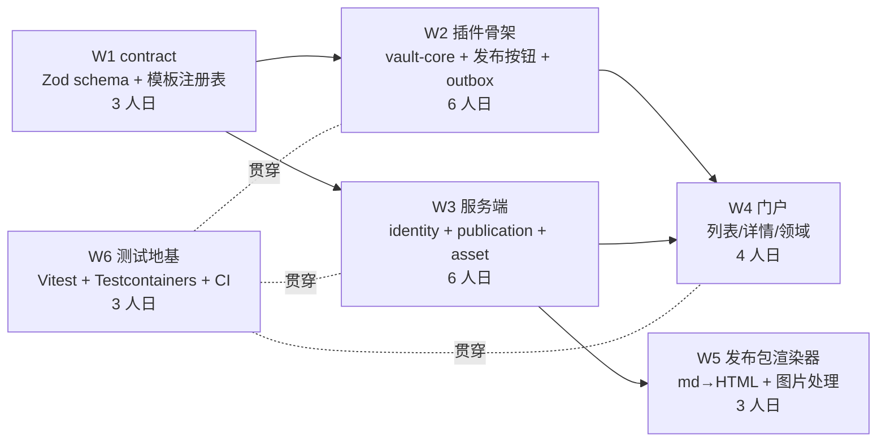

# P0 执行计划 · 一张卡片跑通

> 依据：[架构设计 v1](./研究性学习社区-系统架构设计-v1.md) + [决策锁定](./决策锁定-2026-11-13.md)（单班 ≤30 人 / BYO Key / 个人主体 / 发布包口径）
> 周期：3 周（1 人全职或 2 人半职）

---

## 0. P0 只有一个目标

> **一张精读卡片：在 Obsidian 里写完 → 点发布 → 服务器落库 → 门户出一个可分享的 URL，含图，全程 < 30 秒。**

不做 AI、不做评论、不做实践卡片、不做领域总结。**先把最窄的一条竖线打穿**，其余功能都是往这条线上挂。

---

## 1. 验收清单（12 条可测断言）

P0 结束当天，下面每条都要能被一条自动化测试或一次手工演示证明：

| # | 断言 | 类型 |
|---|---|---|
| A1 | `dr-card@1` 的 Zod schema 能解析合法卡片，拒绝缺 `aha` 字段的卡片 | 单测 |
| A2 | `aha.quote` 超过 300 字被拒绝，299 字通过 | 单测 |
| A3 | `schema: dr-card@2` 返回 `CARD_SCHEMA_UNSUPPORTED`，而不是"尽力解析" | 单测 |
| A4 | 含 `application/pdf` 的资产被拒绝，图片通过 | 单测 |
| A5 | 同一 `(author, clientCardId)` 重复发布 → 返回同一条 publication，不产生第二条 | 集成 |
| A6 | 发布 → 断网 → 恢复 → 自动重试成功（outbox） | 集成 |
| A7 | 门户 `/c/{id}` 服务端渲染出正文 HTML，首屏无 JS 也能读 | E2E |
| A8 | 图片经对象存储 + 预签名 URL 正常显示，非公开 bucket 不可直连 | 集成 |
| A9 | 改稿发布产生 `revision+1`，旧链接仍可访问且显示最新版 | 集成 |
| A10 | 发布包 `PublishBundle` 能导出 `article.html` + `assets/` + `meta.json`，HTML 内联样式在公众号编辑器粘贴后不丢 | 手工 |
| A11 | 未登录访问 `/c/{id}` 可读；发评论要求登录（P0 仅返回 401，不做评论 UI） | E2E |
| A12 | 服务端模板渲染 round-trip：`render → parse → 与原 DTO 等价` | 单测 |

---

## 2. 六个工作包



| 包 | 内容 | 人日 | 交付物 |
|---|---|---|---|
| **W1 contract** | `packages/contract`：四类卡片 schema、模板注册表、错误码、API DTO、发布就绪校验 | 3 | ✅ **已完成**：33 个测试通过，`tsc` 产物可 import |
| **W2 插件骨架** | `vault-core`（目录布局、frontmatter 读写）、精读卡片表单、AI 起草、Mermaid 视觉图、发布按钮、`publish-outbox.jsonl` | 6 | ✅ **已完成第一增量**：可安装 zip（161KB），34 个单测通过，见 [apps/obsidian-plugin](../apps/obsidian-plugin/README.md) |
| **W3 服务端** | Fastify：发布接口、读接口、模板接口、资产本地存储、评论开关 | 6 | ✅ **已完成第一增量**：9 张表迁移 SQL、13 个单测、HTTP 冒烟通过，见 [apps/api](../apps/api/README.md) |
| **W4 门户** | Next.js：列表（按领域）、详情页、作者页、OG meta | 4 | ✅ **已完成第一增量**：列表 + 详情 + OG meta，SSR 读取 API，见 [apps/portal](../apps/portal/README.md) |
| **W5 发布包** | Markdown → 语义 HTML（内联样式）、图片转 WebP 两档、`meta.json`、ZIP 导出 | 3 | `PublishBundle` zip |
| **W6 测试地基** | Vitest 双 project、`obsidian-test-mocks` 接入、Testcontainers、CI P1 档（≤6min） | 3 | `pnpm test` 绿 |

> W2 与 W3 只通过 `packages/contract` 交汇，可以**两个人并行**：一方改 schema 前先在 contract 提 PR。

---

## 3. 目录骨架

```
研究性学习/
├─ pnpm-workspace.yaml
├─ tsconfig.base.json
├─ packages/
│  ├─ contract/              ← W1，唯一契约源（Zod）
│  └─ vault-core/            ← W2，纯 TS，禁止 import obsidian
├─ apps/
│  ├─ obsidian-plugin/       ← W2
│  ├─ api/                   ← W3（NestJS）
│  └─ portal/                ← W4（Next.js）
└─ docker-compose.yml        ← W3/W6
```

**硬规则（CI 机械检查，不靠自觉）**：
1. `contract` 与 `vault-core` 不得 import `obsidian` / `@nestjs/*` / `next`。
2. 插件源码出现裸 `fetch(` 即失败，网络必须走 `requestUrl`。
3. 任何 `assets` 白名单外的 MIME 不得进入上传路径。

---

## 4. 三周节奏

| 周 | 主线 | 周末可演示的东西 |
|---|---|---|
| **W1** | W1 完成 + W2/W3 骨架 + W6 地基 | `pnpm test` 绿；contract 能解析四类卡片；CI 跑通 |
| **W2** | W2 插件发布链路 + W3 服务端发布/读接口 | 插件里点按钮 → 数据库里有一条 publication |
| **W3** | W4 门户 + W5 发布包 + 打磨 A1–A12 | 浏览器打开一个 URL 看到卡片；导出一个 zip 粘进公众号 |

**每周五做一次"竖线演示"**，不允许"下周一起看效果"。

---

## 5. 明确不做（省约 8 人日）

- AI 调用、文献检索（P1）
- 评论、点赞、转发、讨论树（P2）
- 实践卡片、总结类卡片（P1，schema 先定但不做 UI）
- 公众号 / 小红书 API 对接（P0 只做发布包导出）
- 多租户、SSO、微信登录、教师看板
- 移动端适配（桌面优先，按 Q11 默认值）

---

## 6. 前三个风险与触发条件

| 风险 | 触发信号 | 立即动作 |
|---|---|---|
| 插件与真实 Obsidian 行为不一致（mock 漂移） | 单测全绿但手动装插件报错 | 当天装一次真实插件验证，别等下周 |
| 发布包在公众号编辑器里样式丢失 | 粘贴后段落塌陷、图片裂 | 改用表格布局兜底；微信会清洗 `class`，只用内联 `style` |
| 对象存储预签名 URL 过期导致门户图片 403 | 卡片放几小时后图挂 | 详情页图片走服务端代理或延长有效期，别用 5 分钟默认值 |
