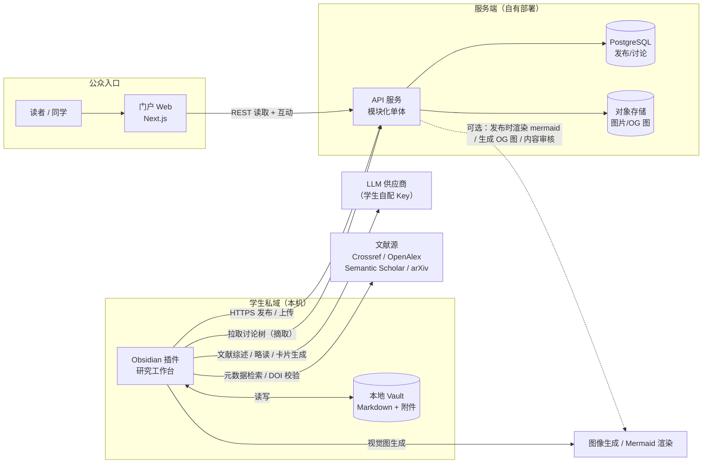
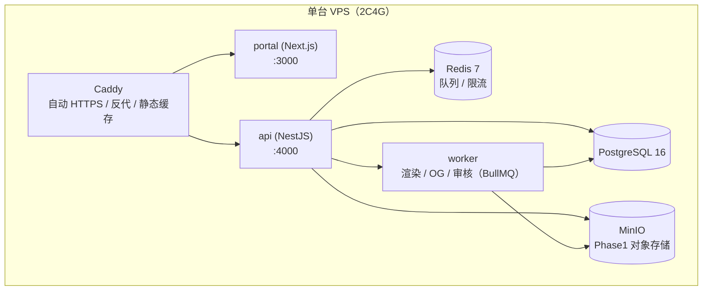
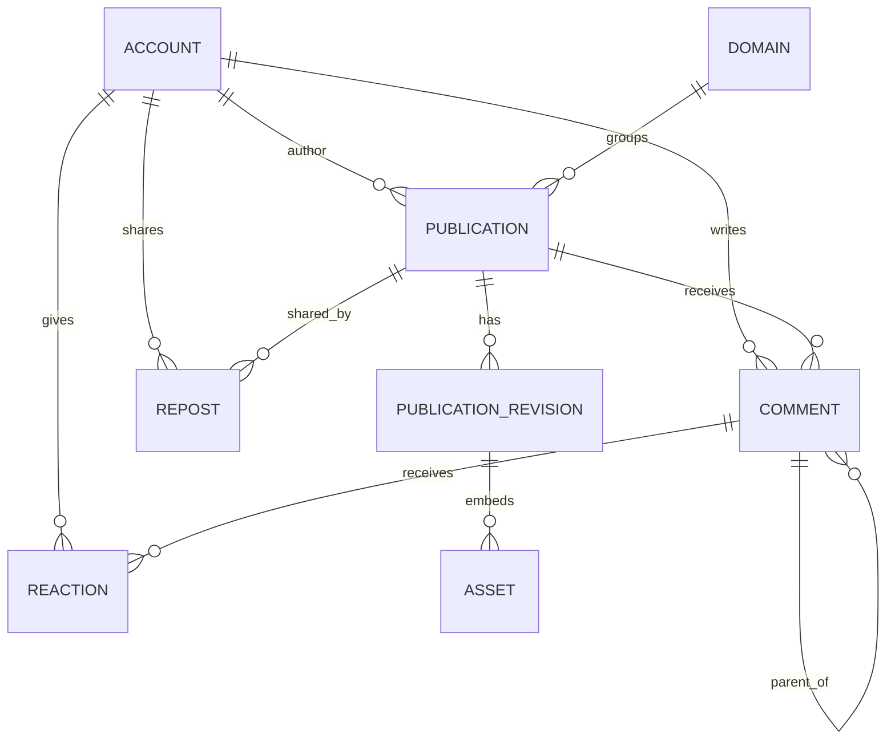
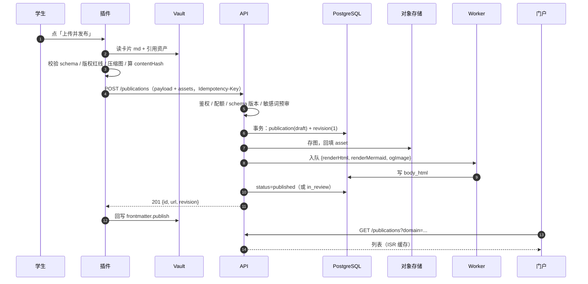

# 研究性学习社区 · 系统架构设计 v1.0

> 状态：待评审（Draft）｜日期：2026-11-13｜范围：Obsidian 插件端、服务器端、公众入口端
> 本文档只做架构决策与边界定义，不含实现代码。所有"待拍板"项集中在第 11 章。

---

## 0. 一页纸结论（TL;DR）

**一句话架构**：这是一个"**私域深度加工 + 公域轻发布**"的系统。Obsidian 是学生的工作台（重模型、富内容、只在本地）；服务器是公共广场的**发布与讨论层**（薄模型、快照、只在明示动作时接收数据）；公众入口只是快照的**读与互动视图**。

**主数据流只有一条**：

```
本地 Markdown（真相） --[学生点按钮]--> 发布快照（服务器真相） --> 门户阅读/讨论 --> 摘取回本地（新的本地卡片）
```

**五个"定了就不容易改"的决策**（详见附录 A）：

| # | 决策 | 一句话理由 | 反转成本 |
|---|---|---|---|
| D1 | 本地优先，Vault 是私域唯一真相，服务器**不反向写 Vault** | 学生断网、没账号、AI 没配额时，研究流水线必须能跑完 | 高 |
| D2 | **Markdown + YAML frontmatter** 同时是存储格式与跨端契约，schema 用 Zod 版本化 | 任何一端重写，数据都还能用；Obsidian 原生可读可编辑 | 中 |
| D3 | 服务器是**模块化单体**（NestJS + PostgreSQL + 对象存储），不拆微服务 | 一个班到一所学校的量级，拆服务只会增加运维而不是解耦 | 低 |
| D4 | 发布 = **不可变快照 + 修订链**，评论挂在 publication 上而非 revision 上 | 学生改稿不破坏已发生的讨论；撤回可追溯 | 中 |
| D5 | 私域内容生成 AI **只在插件端**（学生自带 Key），服务端只提供模板/提示词 + 可选的审核与封面 | 学生的半成品和失败稿不该经过学校服务器；成本归属清晰 | 中 |

**不建议现在做的事**：微服务、图数据库、实时协同编辑、双向全量同步、自动外发第三方社媒。理由见 2.3 与 10。

---

## 1. 问题与约束

### 1.1 业务目标

一个班级/社团的学生，围绕一个**领域**选题，走完"文献综述 → 略读筛选 → 精读卡片 → 实践验证 → 总结"的完整研究闭环，并把其中"值得公开"的成果发布到社区，引发同学讨论，讨论又回流成新的研究素材。

### 1.2 三类角色与关键场景

| 角色 | 场景 | 对架构的硬要求 |
|---|---|---|
| 学生（作者） | 在 Obsidian 里做文献→卡片→总结；一键发布 | 离线可用、AI 可自配、发布可控（选哪些上传） |
| 读者/同学 | 浏览器按领域/姓名浏览卡片，注册后评论点赞转发 | 免客户端、首屏快、可分享链接、移动端可用 |
| 教师/组织者（可选） | 看班级产出、抽查、处理举报 | 只读看板 + 审核队列，不进入学生私域 |

### 1.3 已知约束（来自需求）

1. **只有学生明示选择的内容才上传**——这是一条产品红线，也是架构红线：默认零上传。
2. 卡片有**固定模板**（精读 Aha 五点、实践计划/过程/总结），模板由服务器提供 —— 意味着**模板是跨端契约**，必须有版本。
3. 需要"**读公众入口讨论树摘取内容做卡片**"——公域 → 私域有回流通道。
4. 需要"**AI 转视觉图**"——图像资产要落盘、要能随卡片发布。
5. 三端并发演进，学生开发者可能轮换 —— 边界要比"最优"更重要。

### 1.4 明确不在本期范围

校内 SSO、多租户 SaaS、实时协同、移动 App、视频内容、付费订阅、第三方平台自动发帖。

---

## 2. 整体架构与技术选型

### 2.1 系统上下文（C4 Level 1）



**读法**：插件不与 DB 对话，门户不与 Vault 对话，二者只通过边界明确的 HTTP API 交汇。所有 AI 的实线都从插件出发——这是 D5。

### 2.2 部署视图（C4 Level 2，Phase 1 单机形态）



演进到 Phase 2/3 时，只有三处变化：MinIO→云 OSS + CDN、PG→托管实例、worker 独立成一台。API 契约不变。

### 2.3 技术选型与"为什么不选另一条"

| 层 | 选择 | 关键备选 | 为什么选它 / 为什么不选备选 |
|---|---|---|---|
| 插件运行时 | TypeScript + esbuild + Obsidian API | — | 唯一可行；Obsidian 插件必须跑在 Electron 渲染进程 |
| 插件 UI | **Preact**（卡片编辑表单）+ 原生 DOM（其余） | React（包大）、纯 DOM（表单难维护） | Preact ~4KB，足够做 Aha 五点这类结构化表单 |
| 网络 | Obsidian `requestUrl` | `fetch` | `requestUrl` 绕过 CORS，且插件商店审核对裸 `fetch` 敏感 |
| 跨端契约 | pnpm workspace + `packages/contract`（Zod + TS） | JSON Schema 手写 / OpenAPI 生成 | 一种定义三端复用，运行时校验与静态类型同时拿到 |
| 服务端 | **NestJS**（Node 22 + TS）+ Prisma | Fastify（更轻）、Go（团队不熟） | 模块系统天然映射本文的 bounded context；学生轮换开发时"目录即边界"，腐化慢。1 人开发可降级为 Fastify，但会把边界纪律交给自觉 |
| 数据库 | PostgreSQL 16 | MongoDB（无强约束）、SQLite（并发弱） | 发布/评论/修订需要事务与外键；JSONB 存 frontmatter 足够 |
| 队列 | Redis + BullMQ | 无队列（同步渲染） | mermaid/OG 渲染是秒级 CPU 任务，必须异步，否则发布接口超时 |
| 对象存储 | MinIO → 阿里云 OSS / R2 | 直接存 PG bytea | 图片必须走 CDN 与预签名 URL，不进数据库 |
| 门户 | **Next.js（App Router）+ Tailwind + shadcn/ui** | Astro（评论弱）、纯 SPA（SEO 差） | 需要分享链接可被微信/搜索引擎抓取 → SSR/ISR |
| 门户鉴权 | 读者：邮箱验证码 / 微信扫码（后期）；学生：设备码授权 | 密码登录 | 学生端在插件里输密码体验差且不安全 |
| 搜索 | PG `pg_trgm` + 关键词 | Meilisearch / ES | 数据量 <1 万卡片时 PG 足够；留出替换点 |
| AI | 插件端 provider 抽象（OpenAI 兼容） | 服务端统一网关 | 见 D5 与第 7 章 |
| 部署 | Docker Compose + Caddy | K8s | 单机能跑到几千用户，K8s 属于过度设计 |

### 2.4 代码仓库结构（monorepo）

```
research-learning/
├─ packages/
│  ├─ contract/          # ★ 唯一契约源：Zod schema、TS 类型、错误码、模板 ID、API DTO
│  ├─ vault-core/        # 纯 TS，无 obsidian 依赖：目录布局、frontmatter 读写、模板渲染、slug
│  └─ ai-kit/            # provider 抽象、prompt 组装、重试/缓存/成本计数
├─ apps/
│  ├─ obsidian-plugin/   # 只做 UI 与编排，读写走 vault-core，网络走 contract
│  ├─ api/               # NestJS：modules/{publication,engagement,template,asset,identity,moderation,portal-read}
│  └─ portal/            # Next.js
├─ docs/
│  ├─ adr/               # 架构决策记录
│  └─ api/openapi.yaml
└─ docker-compose.yml
```

**依赖方向硬规则**：`contract` 与 `vault-core` 不能依赖 `obsidian`、`nestjs`、`next`。这条规则可以用一个 CI 脚本（禁止 import 名单）机械检查——这是防腐化最便宜的一招。

---

## 3. 三端模块划分与边界

### 3.1 Obsidian 插件端：10 个模块

| 模块 | 职责 | 明确不做 |
|---|---|---|
| `vault-store` | 目录布局、frontmatter 读写、原子写、模板渲染成 md、附件落盘 | 不做业务判断 |
| `research-pipeline` | 文献状态机（`新读入→已综述→已略读→精读中→已精读→已实践`）的编排与校验 | 不直接调 AI（经 `ai` 模块） |
| `library` | 文献元数据、DOI/arXiv ID、PDF 附件路径、去重、引用键（citekey） | **不上传 PDF** |
| `ai` | provider 抽象、prompt 组装、速率/成本、结果缓存、失败可重试 | 不写文件（返回结构化对象） |
| `card-studio` | 略读报告 / 精读 Aha 卡 / 实践卡 / 各类总结的生成与表单编辑 | 不负责发布 |
| `visual` | mermaid 源码生成、生图 prompt、图片落 `assets/`、嵌入卡片 | 不做图片托管 |
| `publish-client` | 发布前校验、打包、幂等、离线 outbox、回写发布元信息 | **不做全量同步** |
| `community-inbox` | 拉取讨论树、摘取成新卡片、记录来源 | 不修改已发布内容 |
| `templates` | 拉取服务端模板+schema，带 ETag 缓存，内置离线兜底副本 | 不做版本迁移（迁移脚本单独） |
| `settings` | 服务器地址、设备令牌、模型渠道、默认领域 | 不存明文大模型 Key 在 vault（用 Obsidian secretStorage） |

**插件的三个"不许"**（写进贡献指南，PR 时对照）
1. 不许把 `文献PDF/` 下的文件读出来发网（版权与体积双重原因）。
2. 不许在无用户点击的情况下发起任何网络请求（发布是唯一出口，且必须可见）。
3. 不许在插件里实现"从服务器拉取并覆盖本地卡片"的逻辑。

### 3.2 服务端：7 个模块（同一进程内，模块间只经应用服务调用）

```
apps/api/src/modules/
├─ identity/       账号、邀请码、设备码授权、读者注册、角色
├─ template/       模板注册表（md 模板 + JSON Schema + prompt），版本化 + ETag
├─ publication/    发布、修订、撤回、可见性、slug、快照渲染
├─ asset/          图片入库、压缩、签名 URL、OG 图
├─ engagement/     评论树、点赞/收藏、转发、通知
├─ moderation/     规则预审、举报、审核队列、封禁
└─ portal-read/    面向门户的聚合读模型（列表/详情/个人主页/搜索）
```

每个模块内部固定四层，依赖只能向内：

```
http (controller/dto) → application (use case) → domain (实体/不变量) → infra (prisma/s3/queue)
```

**服务端的三个"不许"**
1. 不许提供"全量笔记同步/双向 diff"接口。
2. 不许在校验通过前把学生内容对外可见（草稿态隔离）。
3. `portal-read` 不许绕过 publication 的可见性判定直接查表（用 repository 提供的 `visibleTo()`）。

### 3.3 公众入口：5 个区块

| 区块 | 内容 | 渲染 |
|---|---|---|
| 浏览 | 按领域、按同学、按卡片类型；卡片流 | ISR，60s revalidate |
| 详情 | md 快照渲染 + 图 + 来源（DOI 链接）+ 作者 | ISR + 客户端互动组件 |
| 讨论 | 评论树、点赞、转发 | CSR（登录后） |
| 个人页 | `/u/{handle}`：该同学已发布的卡片 | ISR |
| 注册/登录 | 邮箱验证码；后期微信 | CSR |

### 3.4 边界权威矩阵（谁说了算）

| 数据 | 存在哪 | 权威方 | 跨端方向 |
|---|---|---|---|
| 文献、略读报告、精读/实践卡片草稿、AI 对话记录 | 本地 Vault | **本地** | 不出本机（除非发布） |
| 各类总结（文章/领域） | 本地 Vault，可发布 | **本地** | 单向 → 服务器 |
| 发布快照（含图） | 服务器 | **服务器** | 本地只回写 `id/url/revision/hash` |
| 评论、点赞、转发、举报 | 服务器 | **服务器** | 单向 → 本地（只读，摘取时复制） |
| 模板与 schema | 服务器发布，本地缓存 | **服务器**（版本协商） | 服务器 → 本地 |

**一句话**：跨端只有一个写方向（本地→服务器，且仅限明示发布），其余全是读。这条规则消灭了这一类系统 90% 的同步冲突。

---

## 4. 核心数据模型

### 4.1 本地 Vault 布局

```
研究性学习/
├─ 00-系统/
│  ├─ templates/          模板缓存（按 schemaVersion 分目录）
│  └─ publish-outbox.jsonl 待发布队列（失败重试用）
├─ 领域/
│  └─ 单元设计/
│     ├─ 领域总结-阅读.md      （kind: domain_summary）
│     ├─ 领域总结-实践.md
│     └─ 主题/大概念统领下的单元/
│        ├─ 主题综述.md        （AI 文献综述）
│        ├─ 文献/
│        │  ├─ zhong2015.md          文献元数据卡（frontmatter 承载）
│        │  └─ zhong2015-略读.md      略读报告
│        ├─ 精读卡片/dr-7f3a2c.md
│        ├─ 实践卡片/pc-91b0e1.md
│        ├─ 文章总结/zhong2015-总结.md
│        └─ assets/dr-7f3a2c-aha.png
└─ 公众摘取/2026-11-13-讨论摘取-3f2a.md
```

约定：**一个卡片一个文件**（便于 diff、便于单独发布、便于版本控制）；**文件名不含中文路径风险字符**；卡片间用 Obsidian `[[wikilink]]` 互链，发布时转成服务器 URL 或降级为纯文本。

### 4.2 卡片 frontmatter 契约（核心三型）

**精读卡片 `dr-card`**

```yaml
---
schema: dr-card@1
cardId: 7f3a2c1e-...        # 全局唯一，客户端生成，发布幂等键
kind: deep_read
domain: { name: 课程与教学论, slug: curriculum-theory }
theme: 单元设计
source:
  type: literature
  citekey: zhong2015
  doi: 10.xxxx/xxxxx
  title: 单元设计：撬动课堂转型的一个支点
  authors: [钟启泉]
  year: 2015
title: 单元是一条学习经验链，不是一个内容包
aha:
  quote: 「……」              # 原文摘录（限 300 字，版权红线）
  experience: 「……」         # 我的生活/教学体验
  insight: 「……」            # Aha：为什么它推翻了我原来的想法
  inspiration: 「……」        # 新启发
  meaning: 「……」            # 对生活的意义
conceptValue:                # 观念价值
  level: 高                  # 高/中/低
  note: 改变了「单元=教材章节」的默认假设
actionGuidance:              # 行动指导（可执行，非口号）
  - action: 把下周的两课时改成一个单元来设计
    trigger: 备课时
    metric: 能写出单元的「大概念」与「表现性任务」
visuals:
  - kind: mermaid
    path: assets/dr-7f3a2c-aha.mmd
  - kind: image
    path: assets/dr-7f3a2c-cover.png
    prompt: "……"             # 保留 prompt 以便复现/重生成
publish:                     # 插件回写，学生不需要手填
  id: pub_01J...
  url: https://xx.dev/c/01J...
  revision: 2
  hash: sha256:...
  at: 2026-11-13T10:00:00+08:00
  visibility: public
createdAt: 2026-11-12T21:10:00+08:00
updatedAt: 2026-11-13T09:55:00+08:00
---
```

**实践卡片 `pc-card`**：`plan { goal, steps[], resources[], schedule, successCriteria }` ＋ `process[] { date, what, evidence, obstacle, adjust }` ＋ `summary { outcome, delta, nextTime }` ＋ `linkedCards[]`（引用哪张精读卡片）。过程是**追加型数组**，天然可增量同步、可回放。

**总结 `sum-*`**：`article_summary`（一篇文献）、`domain_summary`（领域阅读/实践总结，带 `index: [cardId]` 索引）。

**通用信封**（所有卡片共用）：`schema / cardId / kind / domain / tags / publish / createdAt / updatedAt`。

> **设计要点**：`schema: dr-card@1` 是版本锚点。服务端只接受它认识的版本；不认识就拒收并提示升级插件，绝不"尽力解析"。

### 4.3 服务端关系模型



核心表（节选关键字段，非完整 DDL）：

```sql
-- 账号：学生与读者统一，靠 role 区分
account(
  id uuid pk, handle text unique,        -- 公开路由用，如 zhong-laoshi
  display_name text,                     -- 展示名（可真名/昵称）
  role text,                             -- student | reader | teacher | admin
  cohort_id uuid, email citext unique,
  status text, created_at timestamptz
)

domain(id, slug text unique, name text, description, owner_id, visibility)

-- 发布：head + 不可变修订
publication(
  id text pk,                            -- pub_ + ulid，可公开
  author_id uuid fk, domain_id uuid fk,
  kind text,                             -- deep_read | practice | plan | article_summary | domain_summary
  title text, slug text,
  client_card_id uuid,                   -- 幂等键之一
  status text,                           -- draft | in_review | published | withdrawn | blocked
  visibility text,                       -- public | community | private
  current_revision int,
  comment_count int, like_count int, repost_count int,
  published_at, updated_at,
  unique(author_id, client_card_id)
)

publication_revision(
  publication_id fk, revision int,       -- PK(publication_id, revision)
  body_md text,                          -- 权威内容，逐字保存
  body_html text,                        -- 渲染缓存
  frontmatter jsonb,                     -- 结构化字段（Aha 五点等，供筛选/搜索）
  content_hash text,                     -- sha256，判重与"是否有改动"
  created_at timestamptz,
  PK (publication_id, revision)
)

asset(id, publication_id, revision, kind, storage_key, mime, bytes, width, height, sha256)

comment(
  id uuid pk, publication_id fk, parent_id uuid null, author_id fk,
  path text,                             -- 物化路径 '0002.0001'，定宽 4 位
  depth smallint,                        -- ≤ 4
  body text, status text,                -- visible | hidden | deleted
  created_at, edited_at
)

reaction(account_id, target_type, target_id, kind, created_at, PK(account_id,target_type,target_id,kind))
repost(account_id, publication_id, note, created_at)      -- 转发=引用，出现在转发者主页
report(id, target_type, target_id, reporter_id, reason, status)
```

**四个建模决定**

1. **`frontmatter jsonb` 与 `body_md` 并存**：前者供服务端筛选/搜索/Aha 摘录展示，后者是逐字权威。宁可存两份，也不要在读路径上解析 Markdown。
2. **`publication_revision` 不可变**：改稿 = 追加一行；`publication.current_revision` 只是指针。评论挂在 `publication.id` 上，因此永远不丢。
3. **评论树用物化路径**（`path` + `depth`）：取整棵子树 `WHERE path LIKE '0002.%' ORDER BY path`，一条索引搞定；不引入 `ltree` 扩展以降低部署门槛。深度上限 4，超过只能回复根节点（防无限套娃）。
4. **计数去规范化**（`comment_count` 等）：列表页不 join，靠事务内自增 + 每小时对账任务修正。

### 4.4 三条状态机

```
文献：  新读入 → 已综述 → 已略读 →(值得精读?)→ 精读中 → 已精读 →(值得实践?)→ 已实践
                                            └──否──→ 归档（不精读，保留略读报告）

卡片：  草稿 → 待发布(本地已校验) → 已发布 ⇄ 已修订
                              └→ 发布失败(outbox 重试) → 撤回(withdrawn)

评论：  visible → hidden(作者/管理员) → deleted(软删，保留树结构)
```

---

## 5. API 契约

### 5.1 通用约定

| 项 | 约定 |
|---|---|
| Base | `https://api.<domain>/api/v1` |
| 认证 | 插件：`Authorization: Bearer <device_token>`（设备码授权换取，长期有效可撤销）；门户：HttpOnly Cookie 会话 |
| 版本 | 路径版本 `/v1`；破坏性变更开 `/v2`，`/v1` 至少保留 6 个月并回 `Sunset` 头 |
| 幂等 | 写接口接受 `Idempotency-Key`；发布额外有 `(author_id, client_card_id)` 唯一约束 |
| 错误 | `{"error":{"code":"CARD_SCHEMA_UNSUPPORTED","message":"…","details":{…},"requestId":"…"}}` |
| 分页 | 游标：`?cursor=...&limit=20` → `{"items":[...],"nextCursor":"..."}` |
| 时间 | 一律 ISO8601 带时区；服务端存 UTC |
| 限流 | 读 60/min，写 20/min，评论 10/5min；超限 `429` + `Retry-After` |

### 5.2 端点总表

| 方法 | 路径 | 端 | 说明 |
|---|---|---|---|
| POST | `/auth/device/code` | 插件 | 取设备码，展示给学生在浏览器确认 |
| POST | `/auth/device/token` | 插件 | 轮询换 token |
| GET | `/me` | 插件/门户 | 当前账号 |
| GET | `/templates` | 插件 | 全部模板 + JSON Schema + `schemaVersion`（ETag 缓存） |
| POST | `/publications` | 插件 | **发布**（multipart：`payload` JSON + `assets[]`） |
| PATCH | `/publications/{id}` | 插件 | 提交新修订（同样 multipart） |
| POST | `/publications/{id}/withdraw` | 插件 | 撤回 |
| GET | `/publications/{id}/source` | 插件 | 取原始 md + frontmatter（用于"从服务器恢复我发布的版本"） |
| GET | `/publications` | 门户/插件 | 浏览：`domain`/`author`/`kind`/`q`/`sort` 过滤 |
| GET | `/publications/{id}` | 门户 | 详情（含渲染 html、作者、来源 DOI） |
| GET | `/threads/{publicationId}` | 门户/插件 | 评论树（嵌套结构，最深 4 层） |
| POST | `/comments` | 门户 | 发表评论/回复 |
| PATCH/DELETE | `/comments/{id}` | 门户 | 编辑（10 分钟内）/软删 |
| PUT | `/reactions` | 门户 | 点赞/收藏（幂等 upsert）；`DELETE` 取消 |
| POST | `/reposts` | 门户 | 转发（可带一句话） |
| POST | `/reports` | 门户 | 举报 |
| GET | `/domains` | 门户/插件 | 领域列表（含卡片数） |
| GET | `/authors/{handle}` | 门户 | 同学主页 + 其已发布卡片 |
| GET | `/healthz` | 运维 | 健康检查 |

> 完整请求/响应 schema 见 [`docs/api/openapi.yaml`](./api/openapi.yaml)。**服务端与插件都必须从 `packages/contract` 生成/校验，openapi.yaml 是对外说明，不是第二份真相。**

### 5.3 关键契约示例

**发布请求**（`POST /publications`，`multipart/form-data`）

```
payload = {
  "schema": "dr-card@1",
  "clientCardId": "7f3a2c1e-...",
  "kind": "deep_read",
  "domain": { "name": "课程与教学论", "slug": "curriculum-theory" },
  "title": "单元是一条学习经验链，不是一个内容包",
  "bodyMd": "---\nschema: dr-card@1\n...\n---\n\n## 原文\n> …",
  "frontmatter": { "aha": {...}, "conceptValue": {...}, "actionGuidance": [...] },
  "assets": [ { "localPath": "assets/dr-7f3a2c-aha.png", "role": "visual", "sha256": "..." } ],
  "source": { "type": "literature", "doi": "10.xxxx/xxxxx", "title": "…" },
  "visibility": "public",
  "acknowledge": { "noPdfUploaded": true, "citeLengthUnder300": true }
}
assets[] = 二进制文件（同名对齐 payload.assets[].localPath）
```

**响应 `201`**

```json
{
  "publication": {
    "id": "pub_01JB7X2Q0K",
    "url": "https://community.example.dev/c/pub_01JB7X2Q0K",
    "revision": 1,
    "status": "published",
    "slug": "unit-as-learning-experience-chain",
    "contentHash": "sha256:9f2c…",
    "publishedAt": "2026-11-13T10:02:11+08:00"
  },
  "warnings": [
    { "code": "DOMAIN_CREATED", "message": "领域「课程与教学论」已新建，请确认拼写是否与同学一致" }
  ]
}
```

**失败响应 `409`（同内容重复发布）**：返回既有 `publication`，`code: DUPLICATE_CONTENT`，插件据此回写 frontmatter 并提示"已发布过，无需重复上传"。

**评论树响应 `GET /threads/{id}`**

```json
{
  "publicationId": "pub_01JB7X2Q0K",
  "total": 12,
  "nodes": [
    { "id": "c_1", "parentId": null, "depth": 0, "author": {"handle":"lisi","displayName":"李四"},
      "body": "这个「经验链」的说法和我们做项目式学习时的…", "likeCount": 3, "likedByMe": false,
      "createdAt": "2026-11-13T12:00:00+08:00",
      "replies": [ { "id": "c_2", "parentId": "c_1", "depth": 1, "...": "..." } ] }
  ]
}
```

> 插件"摘取"用的就是这一个接口：选中节点 → `community-inbox` 生成新本地卡片，`source.type: discussion`、`source.nodeId: c_2`，并在本地索引里记 `nodeId` 防重复摘取。**摘取是复制，不是引用同步**——服务器内容之后再改，不影响已摘卡片（这是特性，不是缺陷）。

---

## 6. 插件 ↔ 服务器同步策略

### 6.1 定位：不是同步，是"发布 + 回执 + 只读回流"

| 方向 | 内容 | 触发 |
|---|---|---|
| 本地 → 服务器 | 卡片快照 + 资产 | **仅**学生点"上传并发布" |
| 服务器 → 本地 | `id/url/revision/hash/时间` 回写 frontmatter | 发布成功后自动 |
| 服务器 → 本地 | 讨论树（只读）、公开卡片（只读） | 学生主动浏览/摘取 |
| 服务器 → 本地 | 模板与 schema | 启动时 ETag 协商 |

**永不发生的**：服务器推送修改到本地、本地自动覆盖服务器、后台静默上传。

### 6.2 幂等与冲突

- 幂等三元组：`(author_id, client_card_id, content_hash)`。
  - 同 card → 同 hash → `200 DUPLICATE_CONTENT`，回写已有元信息。
  - 同 card → 新 hash → 走 `PATCH` 生成 `revision+1`。
- 冲突只有一种真实场景：**两台设备同时改同一卡片**。策略是"最后发布者生成新修订"，服务器不合并；插件在发布前提示"服务器上已有 rev.3，你的本地是 rev.3 之后修改的，将以 rev.4 覆盖显示（历史保留）"。
- **不引入 CRDT**。卡片是低频、人类手工编辑的长文，冲突概率极低，解决成本远高于损失。

### 6.3 离线 outbox

```jsonl
{"op":"publish","cardId":"7f3a2c1e","payloadPath":"./00-系统/outbox/7f3a2c1e.json","attempts":0,"lastError":"NETWORK","createdAt":"..."}
```

- 发布失败（断网/服务器 5xx）→ 写 outbox，卡片 frontmatter 标 `publish.state: pending`，界面显示"待重试 · 1"。
- 重试策略：指数退避（30s → 2m → 10m → 1h，上限 12 次），**只对幂等安全的失败重试**；`422 schema` 类错误不重试，直接转"需人工修复"。
- 插件启动时扫描 outbox，且同一 `cardId` 只保留最新一条记录。

### 6.4 撤回与删除

- 撤回（withdraw）：服务器置 `status=withdrawn`，门户 404，评论保留但不可见；本地 frontmatter 记 `publish.state: withdrawn`。
- 学生退课/毕业：提供"全量导出（zip of md + 资产）"与"注销（硬删作者内容，评论作者名脱敏为『已注销同学』）"两个按钮。**这条现在就要有，事后补会很难。**

---

## 7. AI 调用与图片生成落在哪一端

### 7.1 决策：私域生成在插件，公共呈现的加工在服务端

| 能力 | 落点 | 理由 |
|---|---|---|
| 主题 → 文献综述 | **插件** | 输入是学生半成品与选题犹豫，不该过服务器；可离线重试 |
| 文献元数据检索 / DOI 校验 | **插件**（Crossref/OpenAlex/arXiv，`requestUrl`） | 与服务端解耦，避免服务端成为文献代理 |
| 单篇略读报告 | **插件** | 同上；产出直接落本地 |
| 精读 Aha 五点生成 / 改写 | **插件** | 最私密的部分（生活体验），绝不上传 |
| 实践卡片的追问与复盘提示 | **插件** | 同上 |
| 领域总结的归并提纲 | **插件** | 输入是全领域卡片，数据量大且私密 |
| 卡片 → mermaid 结构图 | **插件**生成源码；**服务端**发布时用 `@mermaid-js/mermaid-cli` 渲染 SVG/PNG | md 里存源码（可 diff、可编辑），门户需要静态图（微信抓图/性能） |
| 卡片 → AI 生图（封面/意象图） | **插件**调图像 API，图片随发布上传 | 避免服务端持有学生 Key，也避免平台为图片付费 |
| OG 分享图（社媒预览） | **服务端** | 由快照合成标题+摘要+缩略图，纯服务端的事 |
| 内容审核（涉政/涉黄/辱骂） | **服务端**（可选接入审核 API） | 公共安全责任属于运营方 |
| 语义搜索/相关推荐 | **服务端**（Phase 3 再上） | 需要跨学生语料 |

### 7.2 共享 prompt 与模板注册表（关键设计）

服务端不只是"提供 md 报告模板"，它是**输出契约的注册表**：

```json
GET /api/v1/templates
{
  "schemaVersion": "2026-11-a",
  "templates": [
    {
      "id": "deep_read_card",
      "version": 3,
      "mdTemplate": "## 原文\n> {{quote}}\n\n## 我的生活体验\n…",
      "jsonSchema": { "$id": "dr-card@1", "required": ["aha.quote","aha.insight"], "...": "..." },
      "prompt": { "system": "…", "userTemplate": "…", "outputFormat": "json" },
      "examples": ["…"]
    }
  ]
}
```

- 插件启动拉取，带 `If-None-Match`；失败时用内置兜底副本（版本可能落后，只读提示不阻断）。
- **prompt 版本与学生内容分离**：学生内容里记录 `tplVersion`，日后回溯"这批卡片是用哪版 prompt 生成的"。
- 服务端只接受它认识的 `schema`；模板升级要写迁移器（`dr-card@1 → @2`），并保留至少一个大版本的兼容读。

### 7.3 幻觉与成本控制（这是本系统最大的质量风险）

| 问题 | 控制手段 |
|---|---|
| AI 编造文献/DOI | 综述的每一条引用**必须来自检索结果集**；生成后逐条 Crossref 校验，不存在则标红并要求人工确认；**禁止自由生成参考文献** |
| 综述变成"正确的废话" | prompt 强制"给出立场分歧 + 争议点 + 与你选题的关系"，输出结构固定 |
| Aha 点写成读后感 | 模板要求 `insight` 必须包含"我原来以为是 X，实际上是 Y"的对照；不满足则重生成 |
| Token 成本失控 | 插件端本地计数 + 单卡预算上限（如 8k tokens）+ 结果缓存（同 citekey 不重复摘要） |
| 学生没配 Key | 降级为"模板 + 手动填写"，功能可用但不生成；不阻断研究流程 |

---

## 8. 发布链路设计

### 8.1 端到端时序



**关键顺序**：先落草稿再传资产再转发布态。任何一步失败都停在 `draft`，门户不可见——保证"要么完整可见，要么完全不存在"。

### 8.2 发布前校验清单（插件 + 服务端双重）

| 检查 | 插件 | 服务端 | 失败处理 |
|---|---|---|---|
| `schema` 版本受支持 | ✅ | ✅ | 拒发，提示升级 |
| 必填字段（Aha 五点齐） | ✅ | ✅ | 表单内高亮 |
| 引用原文 ≤300 字 | ✅ | ✅ | 截断提示 |
| **无 PDF/附件二进制** | ✅ | ✅（Content-Type 白名单） | 拒发 |
| 图片 ≤5MB/张、≤10 张 | ✅ | ✅ | 压缩/拒绝 |
| 敏感信息（手机号/身份证/住址） | ✅ 正则提示 | ✅ 记录 | 让学生确认 |
| 敏感词/风险内容 | — | ✅ | 转 `in_review` |
| 封面/摘要缺失 | — | ✅ 自动生成 | 继续 |
| 领域 slug 不存在 | — | ✅ 自动建 + `warning` | 继续 |

### 8.3 服务端渲染策略

- `body_md` 逐字保存；渲染 HTML 用 `markdown-it` + 白名单消毒（`DOMPurify`/`sanitize-html`），**禁止内联 HTML/脚本**。
- mermaid → worker 渲染 SVG，缓存到对象存储，HTML 里用 `` 引用（避免门户加载 mermaid 运行时，首屏快）。
- 图片统一转 WebP（保留原图），生成 480/1200 两档；`srcset` 输出。
- 门户 ISR：详情页 `revalidate: 60`；发布/修订时调用 `revalidatePath` 精确失效。

### 8.4 "发布社媒"的三种解读（需拍板，见 Q5）

| 方案 | 做法 | 成本/风险 | 建议 |
|---|---|---|---|
| A. 自家门户 + 分享卡 | 生成 1080×1440 卡片图 + OG meta，学生手动转发到朋友圈/小红书 | 低，合规风险最小 | **推荐先做 A** |
| B. 门户 + 一键分享组件 | 接入 Web Share API / 微信 JS-SDK 分享 | 中，需要公众号与域名备案 | Phase 3 |
| C. 自动发第三方平台 | 对接小红书/抖音开放平台 | 高：账号风控、内容审核责任、接口不稳定 | **不建议**，最多做"复制文案 + 保存图" |

---

## 9. 部署与分期演进

### 9.1 分期路线

| 期 | 目标 | 交付物 | 验收标准 | 估时（1–2 人） |
|---|---|---|---|---|
| **P0 骨架** | 打通"卡片→md→发布→门户可看" | monorepo、`contract`、6 套模板、插件卡片表单+发布、API 发布读接口、门户列表/详情 | 一张卡片从 Obsidian 到 URL 全程 <30s，含图 | 3 周 |
| **P1 研究流水线** | 文献→略读→精读→实践的闭环 | AI provider、Crossref 检索、略读/精读生成、实践卡、文章总结、领域总结、mermaid 视觉图 | 一名学生能独立完成一个领域 3 篇文献的闭环 | 4 周 |
| **P2 社区** | 讨论与回流 | 读者注册、评论树、点赞、转发、讨论摘取回插件、OG 图 | 10 名同学在门户产生 ≥50 条评论，摘取可用 | 3 周 |
| **P3 治理与规模** | 可运营 | 审核队列、举报、通知、搜索、数据导出/注销、教师看板 | 通过一次内容事故演练 + 一次备份恢复演练 | 3 周 |
| **P4 演进** | 按需 | OSS+CDN、多班级、微信登录、语义检索 | 视规模决定 | — |

**每个分期结束都交付可用的东西**，不做"半年后一起上线"。

### 9.2 部署清单（Phase 1）

```yaml
# docker-compose.yml 结构（示意）
services:
  caddy:    { image: caddy:2, ports: ["80:80","443:443"] }
  portal:   { build: apps/portal }
  api:      { build: apps/api, env: [DATABASE_URL, S3_*, JWT_SECRET] }
  worker:   { build: apps/api, command: "node dist/worker.js" }
  postgres: { image: postgres:16, volumes: ["pgdata:/var/lib/postgresql/data"] }
  redis:    { image: redis:7 }
  minio:    { image: minio/minio }
```

| 项 | 基线 |
|---|---|
| 机器 | 2C4G / 40G SSD（≈¥70/月），吞吐上限约数百 DAU |
| 域名 | `community.<你的域名>` + `api.<你的域名>`；**国内服务器需 ICP 备案**（2–4 周，提前启动） |
| 证书 | Caddy 自动 Let's Encrypt |
| 备份 | 每日 `pg_dump` + 对象存储增量，异地保留 7/30/90 天；每月一次恢复演练 |
| 监控 | Sentry（异常）+ Uptime Kuma（可用性）+ 结构化日志（pino，带 requestId） |
| 指标 | 发布成功率、发布耗时 P95、评论数/人、AI 调用失败率、模板版本分布 |

### 9.3 演进时的"不变量"

无论怎么演进，以下四点不变（写进 ADR，任何改造都要对照）：
1. 跨端写方向仍是单向。
2. 卡片仍是 Markdown。
3. publication 仍是不可变快照。
4. 门户仍只读 API，不直连数据库。

---

## 10. 关键风险

| # | 风险 | 类型 | 影响 | 缓解 | 何时处理 |
|---|---|---|---|---|---|
| R1 | **文献 PDF 版权**：学生把下载的 PDF 传上来 | 法律 | 高 | 技术上禁止二进制上传；只存元数据 + DOI 链接；摘录 300 字上限；发布前二次确认勾选 | P0 硬性拦截 |
| R2 | **未成年人隐私**：按真名公开、评论可爬 | 合规 | 高 | 展示名与真名分离（`handle` 对外）；默认昵称；家长/学校知情；一键导出与注销 | P0 建模，P2 上线前 |
| R3 | **AI 编造文献** | 质量 | 高 | 引用必须来自检索集 + Crossref 校验；不可校验不许发 | P1 |
| R4 | 内容审核责任（辱骂/敏感） | 运营 | 中高 | 先审后发（`in_review`）可配置；举报入口；管理员封禁 | P2 |
| R5 | AI/生图成本失控 | 成本 | 中 | BYO Key；本地预算上限；缓存；服务端不代付 | P1 |
| R6 | 重复/错误发布 | 数据 | 中 | 幂等三元组 + outbox + 撤回 | P0 |
| R7 | 模板口径漂移（学生各写各的） | 一致性 | 中 | 模板+JSON Schema 由服务端版本化，插件强校验 | P0 |
| R8 | 单机故障/数据丢失 | 可用性 | 中 | 每日备份 + 恢复演练；RPO ≤24h，RTO ≤4h | P2 |
| R9 | Obsidian API 变更 / 插件商店审核 | 平台 | 中 | 内容永远是纯 md，最坏情况可脱离插件；用 BRAT 内测分发 | 持续 |
| R10 | 学生不走模板、乱建目录 | 数据质量 | 低 | 目录由插件创建，禁止手建；发布时按 frontmatter 归位 | P0 |
| R11 | 讨论区冷启动（没人评论） | 产品 | 中 | 教师点评 + 每周"最佳 Aha"精选 + 摘取回插件形成正反馈 | P2 |

---

## 11. 需要你拍板的问题清单

> 每项给了**推荐默认值**。你不回，我就按推荐值设计；回一条我改一条。

| # | 问题 | 选项 | 我的推荐 | 影响面 |
|---|---|---|---|---|
| **Q1** | 使用规模：一个班、一个社团、一所学校，还是对外开放注册？ | a) ≤30 人单班 b) 百人级多班 c) 全校 d) 全开放 | **b** | 决定是否需要多租户与配额体系；c/d 要重做权限模型 |
| **Q2** | 学生账号怎么来？ | a) 邀请码 + 邮箱 b) 学校统一认证 c) 老师批量建号 | **a**，留 SSO 接口 | 决定 `identity` 模块复杂度与 onboarding 成本 |
| **Q3** | AI 的钱谁出？ | a) 学生自带 Key b) 平台统一代付 c) 学校采购 | **a + 平台可选代付（Phase 3）** | 直接决定 D5 是否成立；选 b 则必须加 AI 网关、配额、审计 |
| **Q4** | 文献从哪来？是否有知网/学校图书馆权限？ | a) 只有开放获取（arXiv/OA） b) 有机构权限，PDF 本地存 | **a 优先，b 允许本地存但不外传** | 影响 `library` 模块与检索源适配 |
| **Q5** | "发布社媒"具体指什么？ | a) 自家门户 + 分享卡 b) 微信/小红书一键分享 c) 自动发帖 | **a，Phase 3 加 b** | 决定是否要备案公众号、是否要处理第三方风控 |
| **Q6** | 公开页展示什么名字？ | a) 真名 b) 昵称/handle c) 学号脱敏 | **b（默认可改真名）** | 影响 R2 合规与 `account` 模型 |
| **Q7** | 内容审核：先审后发还是先发后审？谁审？ | a) 先发后审 + 举报 b) 先审后发 c) 仅敏感词拦截 | **c（P2），有举报后升级 a** | 决定 `moderation` 是否阻断发布主链路 |
| **Q8** | 部署在哪？ | a) 国内 VPS（需备案） b) 海外 VPS c) 校内服务器 | **a，备案提前 3 周启动** | 影响域名、CDN、访问速度、合规 |
| **Q9** | 视觉图要哪种？ | a) mermaid 结构图 b) AI 生图 c) 两者都要 | **c，但 mermaid 为主** | 决定是否必须接图像 API 与图片托管 |
| **Q10** | 要不要教师/导师角色（点评、看板、审核）？ | a) 要 b) 不要 | **要（只读 + 审核，不进私域）** | 影响权限模型与门户导航 |
| **Q11** | Obsidian 移动端必须支持吗？ | a) 必须 b) 桌面优先 | **b** | 移动端会限制 UI 选型（表单、图片选择器）与内存预算 |
| **Q12** | 学生毕业后数据怎么办？ | a) 全量导出 + 注销 b) 只导出 c) 保留 | **a** | 影响 R2 与 `identity` 的删除路径，必须 P0 建模 |

**另外三个"你现在可能没意识到但要先想清楚"的问题**：

- **Q13｜"领域"是共享词表还是学生自建？** 自建必然分裂（"课程论/课程与教学论/Curriculum Theory"）。推荐：服务端维护领域表，学生发布时可新建但要走"相似名合并"提示。这决定门户的浏览体验。
- **Q14｜一个主题的多张卡片，门户上是平铺还是成组？** 推荐"主题页"聚合（`/t/{themeSlug}`），否则读者看到的是碎片。
- **Q15｜讨论摘取回卡片后，需要"回应原作者"吗？** 如果需要，就要在本地卡片上加 `replyTo.nodeId` 并在发布时回链，这会引入一条公域→私域的**社交回路**，比纯只读复杂一档。推荐 Phase 3 再做。

---

## 12. 附录

### A. 决策记录索引

| ADR | 标题 | 状态 |
|---|---|---|
| [ADR-001](./adr/ADR-001-本地优先与单向发布.md) | 本地优先，Vault 为私域唯一真相 | Accepted |
| [ADR-002](./adr/ADR-002-markdown-frontmatter-作为跨端契约.md) | Markdown + frontmatter 作为跨端契约 | Accepted |
| [ADR-003](./adr/ADR-003-模块化单体不拆微服务.md) | 模块化单体，不拆微服务 | Accepted |
| [ADR-004](./adr/ADR-004-发布即不可变快照.md) | 发布即不可变快照 + 修订链 | Accepted |
| [ADR-005](./adr/ADR-005-私域AI在插件端.md) | 私域内容 AI 在插件端 | Accepted |

### B. 术语

| 术语 | 含义 |
|---|---|
| 私域 / 公域 | 学生本机未发布内容 / 服务器上已发布并可被他人看到的内容 |
| 快照（snapshot） | 某次发布时卡片内容的完整副本，不可变 |
| 摘取 | 把公共讨论中的内容复制成本地新卡片，复制后与来源解耦 |
| 略读报告 / 精读卡片 | 文献的两级加工产物；前者是筛选，后者是 Aha 深加工 |
| 观念价值 / 行动指导 | 精读卡片的两个高阶字段：它改变了什么认知、能让你做什么 |

### C. 本文档未覆盖、但实现前需要补的

1. 各端 UI 线框与字段级表单规范。
2. 提示词全文（建议放 `packages/ai-kit/prompts/` 与服务器模板同源）。
3. 权限矩阵明细（角色 × 资源 × 动作）。
4. 数据迁移策略（`dr-card@1 → @2` 的脚本与回滚）。
5. 教师看板的指标定义。
