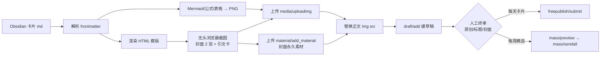
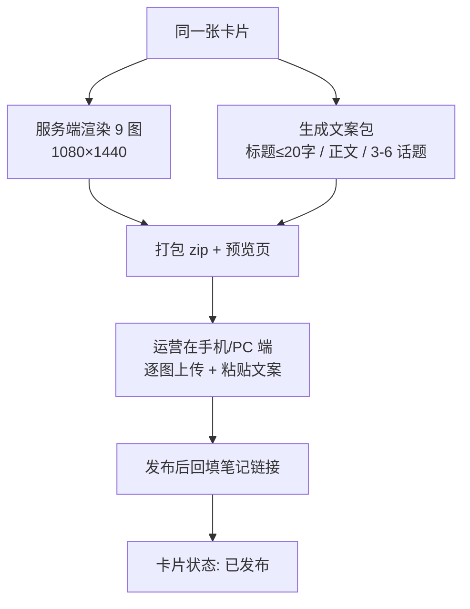
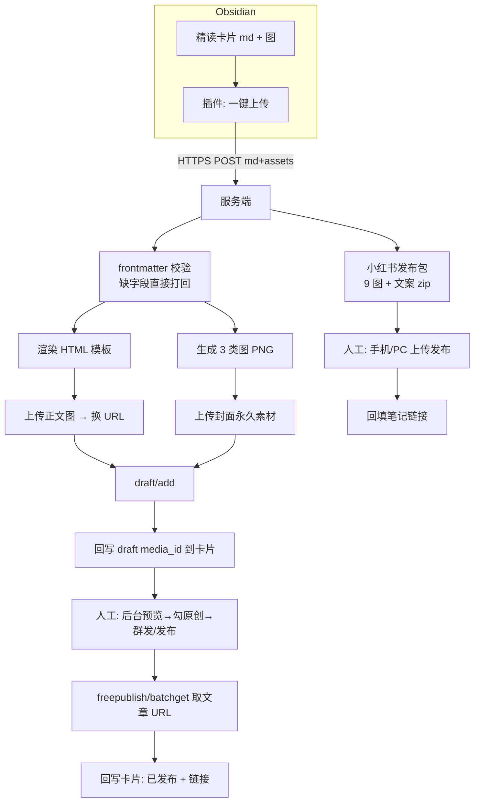

# 研究性学习社区 · 公众号与小红书发布及运营方案

> 版本 v1 · 2026-11-13 · 面向产品链路：Obsidian 精读卡片 / 实践卡片 / 阅读总结 → 一键上传服务端 → 发布到公众号、小红书

---

## 0. 结论先行（先看这 6 条，决定要不要继续投入）

1. **公众号可以做到"内容全自动、发布半自动"，做不到"无人值守发布"。** 草稿入箱、图片上传、封面生成、正文 HTML 全部可自动化；但**原创声明没有接口**、**群发只有 1 次/天且不可撤回**、**API 群发保护会要求管理员在 30 分钟内点确认**——这三点决定了必须保留人工终审。
2. **主体资格是第一道硬门槛，不是技术问题。** 官方文档明确：**2025 年 7 月起，个人主体账号、企业主体未认证账号及不支持认证的账号，被回收「发布能力」接口调用权限**。这意味着"个人先注册个号跑通，以后再认证"这条路径在发布环节会直接断掉。**MVP 之前先确认主体。**
3. **「发布」和「群发」是两套完全不同的能力，必须分开用。** 发布（freepublish）不推送、不占群发次数，适合每天上架卡片；群发（mass/sendall）推送给全部粉丝、每天 1 次、不可撤回，只用于每周精选。把它们混为一谈会立刻踩坑。
4. **小红书没有面向创作者的公开「笔记发布 API」。** 官方开放平台的能力主要面向商家/服务商（电商、广告、数据），发布环节走不了官方 API。**第三方"一键分发"工具 = 交出登录态 + 撞平台风控**，且平台 2026 年 3 月已就"AI 托管代发"发布治理公告（直接封禁）。小红书只能是**人工半自动**。
5. **精读卡片到公众号排版，真正的工作量在图片不在文字。** 公众号正文**会过滤掉外部图片 URL**，所有图必须先经 `media/uploadimg` 上传换 URL；Mermaid/公式/表格必须**预渲染成 PNG**（正文不支持 JS）。所以模板化的核心是"一个卡片 → 三类图 + 一段合规 HTML"。
6. **冷启动的瓶颈在供给侧，不在流量。** 这类社区是双边结构，北极星指标建议定成"**每周新增的被发布有效卡片数**"，而不是粉丝数——粉丝是结果，卡片供给是原因。

---

## 1. 公众号发文流程与 API 能力边界

### 1.1 先分清两个动作

| 维度 | 发布（freepublish） | 群发（message/mass） |
|---|---|---|
| 是否推送给粉丝 | **否**（不进会话，不打扰） | **是**（进会话消息 + 服务通知） |
| 次数限制 | 官方限额 100 次/日（账号级） | **认证订阅号 1 次/天**；认证服务号 4 次/月；**单个用户每月最多收到 4 条** |
| 是否可撤回 | 可删除（不可逆），但无"已读"损失 | **不可撤回**，只能删除已发消息 |
| 主要用途 | 每日卡片上架、SEO/搜索沉淀、分享链接 | 每周精选推送、活动通知 |
| 额外校验 | 内容安全 | **原创校验**（命中原创库会被判转载，见 1.5） |
| 风险 | 低 | **高**（一天一次、不可撤回、有管理员确认环节） |

> 展示位置细节（发布内容在客户端的具体入口）随版本变化，**以内测账号实际效果为准**，不要据此写死产品文案。

### 1.2 接口清单与权限门槛

| 环节 | 接口 | 关键限制 |
|---|---|---|
| 换 token | `GET /cgi-bin/token` | 有效期 7200s，需中控缓存；2000 次/日 |
| 传封面/素材 | `POST /cgi-bin/material/add_material` | 封面 `thumb_media_id` **必须是永久素材 ID** |
| 传正文图片 | `POST /cgi-bin/media/uploadimg` | 返回的 URL 才能在正文用；**外链图片会被过滤** |
| 建草稿 | `POST /cgi-bin/draft/add` | 1000 次/日；title ≤32 字、author ≤16 字、digest ≤120 字、content **<2 万字符且 <1MB**、去 JS |
| 改/查/删草稿 | `draft/update` `draft/get` `draft/batchget` `draft/delete` | 500–1000 次/日 |
| 发布 | `POST /cgi-bin/freepublish/submit` | 100 次/日；**需认证主体**（见 1.3） |
| 发布状态 | `freepublish/get`、`freepublish/batchget` | 100 次/日；用于回写文章 URL |
| 群发 | `POST /cgi-bin/message/mass/sendall` | 每分钟 60 次请求上限；实际 1 次/天（订阅号） |
| 群发前预览 | `POST /cgi-bin/message/mass/preview` | **强烈建议接**：把排版发给自己手机看，比任何本地预览都准 |
| 数据分析 | `datacube/*` 系列 | 认证后可用，用于自动出周报 |

### 1.3 认证主体要求（最关键的一条）

- 官方文档原文（发布能力页脚注）：**"2025 年 7 月起，个人主体账号、企业主体未认证账号及不支持认证的账号将被回收以上接口的调用权限。"**
- 实践含义：
  - **个人主体订阅号 → 不能调发布接口**。可以写、可以建草稿（需实测），但"一键发布"走不通，只能人工在后台点。
  - **企业/其他组织主体 + 微信认证（年审费 300 元/年）→ 订阅号可发布 + 可群发 1 次/天**。
  - 服务号认证后可群发 4 次/月，且出现在消息列表首屏，但**不适合高频内容**。
- **草稿接口是否对未认证主体开放，官方文档未明确标注**，务必在目标账号上实测：返回 `48001 api unauthorized` = 无权限；`40164` = IP 未加白名单（不是权限问题）。
- 注册前必须准备：营业执照/办学许可（如涉及培训）、对公账户、认证公函、运营者身份证。

### 1.4 能否全自动？——分三层回答

| 层次 | 能否全自动 | 原因 |
|---|---|---|
| 内容生产（卡片 → HTML + 图） | ✅ 可以 | 纯服务端渲染 |
| 进草稿箱 | ✅ 可以 | `draft/add` 无人工环节 |
| **正式对外发布** | ❌ **不可以** | ① 原创声明无接口，只能人工勾选；② 群发 1 次/天且不可撤回，误发代价极高；③ 若后台开启"API 群发保护"，需管理员 30 分钟内确认，否则失败；④ 封面裁剪、标题在列表页的截断效果需肉眼确认 |

> 结论：**产品文案不要承诺"一键发布到公众号"，应承诺"一键生成可发布的公众号草稿 + 一键唤起发布确认"。** 这是合规的，也是可信的。

### 1.5 群发的 4 个坑（都会真实咬人）

1. **原创校验会拦截。** 群发时微信会把文章与原创库比对：命中且原创方禁止转载 → **直接不能群发**；命中且允许转载 → 会被替换成原文样式并标注来源。参数 `send_ignore_reprint=0`（默认）时被判转载即停止群发。
2. **`is_to_all=true` 一天只能用一次**，且与后台手动群发共享这一次额度。
3. **重复提交会重复推送。** 必须传 `clientmsgid`（≤32 字节）做幂等；重复会返回 `45065` 并带回已存在的 `msg_id`。
4. **多图文时 `digest` 会被忽略。** 单图文才有摘要；多图文不填摘要时系统抓正文前 54 字——所以**第一段必须写成能独立成立的导语**。

### 1.6 建议的账号结构

| 阶段 | 结构 | 理由 |
|---|---|---|
| MVP（0–3 月） | **1 个认证订阅号** | 每天可群发 1 次，适合日更卡片；成本最低 |
| 增长期 | 订阅号（内容）+ 服务号（服务通知：卡片审核结果、共读提醒） | 服务号只做点对点通知，不做内容 |
| 不建议 | 用服务号做主内容号 | 4 次/月，撑不起内容节奏 |

---

## 2. 精读卡片 → 公众号排版模板化

### 2.1 卡片数据契约（这一步定死，后面全自动才成立）

Obsidian 侧 frontmatter 必须是**结构化字段**，不能是自由文本。建议 schema：

```yaml
---
type: close-reading        # close-reading | practice | digest
title: 论文/书名
authors: [作者1, 作者2]
source: 期刊名/出版社/URL
year: 2024
doi: 10.xxxx/xxxxx          # 有则必填，用于文末引用与查重
license: CC-BY-4.0          # CC-BY / 付费 / 未知（决定能否全文转载）
claim: 一句话核心主张
evidence:                   # 2–5 条，每条含出处（页码/图表号）
  - 证据1（p.12, 图3）
method: 研究方法
limits: 作者承认/我判断的局限
quote: 原文关键句（含页码）
my_note: 我的判断 / 可迁移到我的课题
questions: [待验证问题]
ai_assisted: false          # 见 5.3，决定是否加 AI 标注
---
```

正文用固定小标题（`## 核心主张` `## 证据链` `## 方法拆解` `## 局限` `## 我的批注` `## 延伸问题`），渲染器按标题映射成模板区块——**不要靠 AI 自由发挥结构**，否则排版不可控。

### 2.2 渲染槽位与硬限制

| 槽位 | 取值来源 | 硬限制 / 规则 |
|---|---|---|
| 标题 | `title` + 一句钩子 | ≤32 字（**列表页约 20 字截断，正文标题建议 ≤22 字**） |
| 作者 | 卡片作者昵称 | ≤16 字 |
| 摘要 | `claim` 压缩 | ≤120 字；**多图文时不生效**，所以导语要能独立成立 |
| 封面 | 模板生成 2 张 | 2.35:1（列表）+ 1:1（分享卡片），走 `cover_info.crop_percent_list` |
| 正文 | 模板渲染 | <2 万字符、<1MB、无 JS、图片全部换成微信图床 URL |
| 阅读原文 | 卡片网页版 URL | ≤1KB |
| 声明区 | 固定文案 | 引用来源 + AI 标注 + 社区引导 |

### 2.3 正文模板（可直接落地的区块顺序）

```
① 导语（3 行内，回答"这篇为什么值得读"）
② 原文信息卡（作者/年份/期刊/DOI/许可协议）—— 小字号灰底
③ 核心主张（加粗一句话 + 2 行解释）
④ 证据链（编号列表，每条带页码/图表号）
⑤ 方法拆解（有结构图则插图）
⑥ 局限与争议（作者自述 + 我的判断，两段分开写）
⑦ 原文引用块（1–2 句，左竖线样式，必须标页码）
⑧ 我的批注（这是社区的灵魂，必须有）
⑨ 延伸问题（1–3 个，引到评论区/社群）
⑩ 参考文献（GB/T 7714 格式）
⑪ 声明区（AI 标注 + 授权说明 + 转载规则）
⑫ 社区引导（小程序卡片 / 二维码 / 合集入口）
```

### 2.4 视觉图：三类图 + 一条流水线

| 图型 | 尺寸 | 用途 | 生产方式 |
|---|---|---|---|
| 封面图 | 900×383（2.35:1）+ 383×383（1:1） | 列表页、分享卡片 | HTML 模板 + 无头浏览器截图 |
| 结构图 | 1080 宽，高度自适应 | 概念图/流程图/证据关系图 | Mermaid → PNG（**不要用 SVG，公众号会掉样式**） |
| 引文卡 | 1080×1440（3:4） | 文内金句、小红书首图复用 | 同上，一套模板两处用 |

流水线（服务端一条命令跑完）：



工程要点：
- 截图用 Playwright/Puppeteer，`deviceScaleFactor: 2`，字体固定（思源黑体/思源宋体，**不要依赖客户端字体**）。
- 图片上传后**必须替换 URL 再建草稿**，顺序反了会被过滤成裂图。
- 封面必须先 `add_material` 拿永久 `media_id`，临时素材 ID 会失效。
- 表格在公众号编辑器里样式会被清洗 → **复杂表格一律出图**。
- 公式：KaTeX 渲染后截图，或直接出整块 PNG。

### 2.5 可用的内联样式片段（微信不清洗）

```html
<section style="border-left:3px solid #2b6cb0;padding:8px 0 8px 14px;background:#f7fafc;color:#2d3748;font-size:15px;line-height:1.9;">
  原文引用正文……<br/>
  <span style="font-size:13px;color:#718096;">—— 作者（2024），p.12</span>
</section>
```

> 原则：**只用 `<section>/<p>/<span>/<strong>/` + inline style**，不用 `<style>`、不用 class、不用 JS、不用外链字体。这样在微信编辑器里所见即所得。

### 2.6 发布前质检清单（QA Gate，缺一不可）

- [ ] 标题 ≤22 字，且列表页不出现"……"
- [ ] 导语前 54 字能独立成立（应对多图文无摘要）
- [ ] 所有图片域名是微信图床（`mmbiz.qpic.cn` 等），无外链
- [ ] 封面 2.35:1 与 1:1 裁剪后主体不丢
- [ ] 引用均有页码；参考文献格式统一
- [ ] `license` 为"付费/未知"时，未整段翻译或大段复制原文
- [ ] `ai_assisted=true` 时，声明区已加 AI 标注
- [ ] 手机预览（`mass/preview`）已看过一遍
- [ ] 阅原文链接可打开、无 404

---

## 3. 小红书发布的实际可行路径

### 3.1 官方 API 到底有没有

| 能力 | 官方开放情况 | 对我们的可用性 |
|---|---|---|
| 笔记**发布** | **无面向普通创作者/个人开发者的公开接口**。开放平台（open.xiaohongshu.com）能力集中在电商（千帆）、广告（聚光）、品牌合作（蒲公英）、数据服务，需**企业主体 + 服务商/商家资质**逐项申请 | ❌ 不可作为 MVP 依赖 |
| 笔记**数据** | 商家/服务商侧有数据接口 | ⚠️ 后期可谈，前期手抄 |
| 评论/私信 | 同上，且受权限管控 | ❌ |

> 判断标准：**能拿到正式 API 文档 + 应用审核通过 + 明确的发布 scope，才算"有 API"。** 网上大量"小红书发布 API"教程实际是 cookie 复用或浏览器自动化，不是官方能力。

### 3.2 第三方工具的三层风险

| 风险层 | 具体表现 | 后果 |
|---|---|---|
| 账号安全 | 交出登录态/cookie/扫码授权给第三方；设备指纹异常 | 异地登录提醒、被迫改密、被盗号 |
| 平台规则 | 平台明确禁止"利用技术手段模拟真人、非真实内容创作或虚假互动"；**2026 年 3 月治理公告：直接通过 AI 托管工具注册/发布/互动的账号，或主页所有公开笔记均为 AI 托管代发的账号，予以封禁**；偶发使用则警告/限制分发 | 限流 → 封号，且**申诉成功率低** |
| 数据合规 | 用户卡片内容 + 学生身份信息出境/第三方留存 | 个人信息保护风险 |

> **明确不建议**：把"自动发布到小红书"做成产品卖点。这不是技术能不能的问题，是平台明确要打的方向。可以做"**一键生成发布包**"，不做"一键发布"。

### 3.3 推荐的半自动流程（人机边界清晰）



分工：
- 机器做：出图（首图大字标题、2–9 图逐条拆解、末图引导）、文案草稿、话题推荐、发布清单、链接回填入口。
- 人做：**最终发布动作**、图片顺序微调、话题取舍、评论区首评（引导收藏/进群）。

单人一篇的实操耗时：**5–8 分钟**（9 图上传是最慢的一步，PC 端创作服务平台比手机端快）。

### 3.4 内容形态适配（同一张卡片，两种写法）

| 维度 | 公众号 | 小红书 |
|---|---|---|
| 标题 | ≤22 字，信息型 | ≤20 字，钩子型（"我用这个方法 3 天读完一篇 40 页论文"） |
| 首图 | 2.35:1 封面 | 1080×1440 大字标题卡（**决定点击率**） |
| 正文 | 1500–2500 字，完整论证 | 600–900 字，每条一段，短句 |
| 图 | 结构图为主 | 逐图拆解（一图一观点） |
| 引导 | 阅读原文 / 合集 | 收藏 + 关注 + 评论区领模板 |
| 禁区 | 原创标、引用规范 | **站外引流（微信/二维码）管控严**，用群聊组件/私信自动回复替代 |

---

## 4. 账号定位、栏目规划与内容选题

### 4.1 一句话定位

> **"把'读过'变成'能用'——一个用卡片沉淀研究能力的学习社区。"**

- 核心人群（按付费意愿排序）：① 做课题/综评的高中生及其家长；② 大创/保研/考研的本科生；③ 写文献综述的研究生；④ 带研究性学习的中学教师。
- 差异化：**不卖"知识"，卖"可复用的研究动作"**。别人发书单和摘要，我们发"这张卡片里，哪一句是证据、哪一句是作者的主张、哪一句是我的判断"。
- 一句话说清价值：**"你读完一篇论文，能留下 5 个可以复用的东西。"**

### 4.2 栏目矩阵（公众号为主，小红书做同一内容的再剪裁）

| 栏目 | 频率 | 内容 | 对应卡片 | 目标 |
|---|---|---|---|---|
| **精读示范** | 每周 2 篇（发布）+ 1 篇（群发精选） | 一篇论文/一本书的完整卡片拆解 | close-reading | 建立专业感，搜索长尾 |
| **卡片方法** | 每周 1 篇 | 怎么提问、怎么记证据、怎么画概念图 | 元方法 | 收藏率最高，最好的引流品 |
| **实践复盘** | 每两周 1 篇 | 学生项目从选题到结题的复盘（UGC 征稿） | practice | 社会证明，转化 |
| **社区周报** | 每周 1 次（群发） | 本周新卡片 Top5 + 讨论摘要 + 共读进度 | digest | 留存，制造"在场感" |
| **工具与工作流** | 每月 1–2 篇 | Obsidian 模板/插件/导出链路 | — | 产品软文位，垂类精准引流 |

### 4.3 选题库（首月 20 条，直接排期）

**精读示范（6）**
1. 一篇 40 页的实证论文，我只记住 3 个数字——它们是怎么被选出来的
2. 摘要说的和结论说的不一样：一次"论文自相矛盾"的精读
3. 为什么顶刊论文的"局限"部分最值得读
4. 同一课题，两篇论文结论相反——分歧点在哪一行
5. 一张图读懂 Meta 分析的森林图
6. 被引用 2000 次的那句话，原文其实说的是另一件事

**卡片方法（5）**
7. 精读卡片只写 6 个字段，多一个都是负担
8. "作者说"和"我认为"必须分两栏：一个防止自我欺骗的习惯
9. 怎么判断一段话是证据还是观点（3 个追问）
10. 概念图不是知识图谱：我为什么只用 7 个节点
11. 读完就忘？因为你没有留下"可检索的钩子"

**实践复盘（4）**
12. 一个高中生用 12 张卡片做完一个水质调查课题
13. 从"我想研究睡眠"到"可执行的 3 个问题"：选题收敛全过程
14. 访谈做了 8 个人就饱和了吗——一次失败的样本量复盘
15. 被老师打回 3 次的文献综述，第 4 版改了什么

**工具与工作流（3）**
16. Obsidian 里怎么写一张"能被发布"的卡片
17. 从卡片到公众号：我的一条发布流水线
18. 我用 AI 做了什么、没做什么（附标注规范）

**社区/观点（2）**
19. 研究性学习最大的浪费：把"活动"当"研究"
20. 我们为什么坚持让每张卡片都写"局限"

### 4.4 平台分工

| 平台 | 角色 | 内容密度 | 引流方向 |
|---|---|---|---|
| 公众号 | **信任与沉淀**（长文、合集、可搜索） | 高 | 小程序/社群/课程 |
| 小红书 | **发现与拉新**（首图钩子、收藏型干货） | 低 | 搜公众号名/群聊组件 |
| 视频号 | 后期补充（卡片讲解 60s） | 极低 | 公众号 |

---

## 5. 内容质量与合规风险

### 5.1 原创声明（没有接口，只能人工）

- **事实**：`draft/add` 参数里**没有任何原创声明字段**，原创标只能在公众号后台编辑器里手动勾选；且账号需具备原创声明资格（以编辑器是否出现"声明原创"按钮为准）。
- 因此**原创是人工环节**，产品不要承诺"自动声明原创"。
- 注意两个连带后果：
  1. 未声明原创的文章，**别人可以转载**（会被判为非原创）；声明后别人转载会自动带来源。
  2. 群发时有**原创校验**：如果我们的卡片大量引用某篇原创公众号文章，可能被判为转载而被拦截。
- 建议机制：卡片若 `license` 为付费/未知 → **不整段翻译、不大段引用**，只做"观点 + 我的批注"，引用控制在必要最小范围。

### 5.2 引用文献的边界（学术社区的高压线）

| 场景 | 可以做 | 不可以做 |
|---|---|---|
| 引用原文观点 | 短句引用 + 页码 + 出处 | 连续大段复制（即便标了出处） |
| 翻译外文 | 转述 + 关键术语原文 | 整段/整节翻译后当原创发布 |
| 论文图表 | 自己重绘并标"据 XX 改绘" | 直接截图当自己图（尤其付费期刊） |
| 数据集 | 说明来源+许可 | 未授权商用 |
| 学生作业/卡片 | 征得作者同意（UGC 授权书） | 默认"上传即同意公开"而不告知 |

- 统一引用格式：**GB/T 7714**，文末列全；正文引用标页码。
- 建议在产品里加一个 `license` 字段并在发布前做**阻断式校验**：付费/未知 → 强制走"仅观点转述"模板。

### 5.3 AI 生成内容标注（2025-09-01 起是法定义务）

- 依据：**《人工智能生成合成内容标识办法》2025 年 9 月 1 日施行**，要求 AI 生成合成内容同时具备**显式标识**（用户可见的文字/图形提示）与**隐式标识**（元数据/水印），并对传播平台设定了核验与提示义务。
- 对我们的三条落地动作：
  1. **凡是 AI 参与生成的段落（摘要、观点归纳、配图），必须打标。** 卡片 frontmatter 里 `ai_assisted: true` 是唯一可信来源，渲染器据此**自动插入声明区块**。
  2. 声明文案固定、可追溯，例：`本文部分内容由 AI 辅助整理，已经人工核校；引用与观点以原文为准。`
  3. **AI 生成的配图尤其危险**：读者会把"示意图"当"论文原图"。规则：AI 图**只能做装饰/示意**，且图注必须写"示意图，非原文数据"；**论文数据图一律重绘，不用 AI 生成**。
- 平台侧：公众号与小红书都有 AI 内容标识/提示机制，发布时若平台提供"AI 生成"选项，**如实勾选**。不要为了让内容"更像人写的"而隐藏 AI 参与——这是法规问题，不是风格问题。

### 5.4 其他红线（这个赛道特有）

| 风险 | 说明 | 处置 |
|---|---|---|
| 教育宣传合规 | 不得承诺"综评加分/强基入围/包获奖/保过" | 全部文案禁用语进词表，发布前机检 |
| 学科培训边界 | 若涉学科应试培训，需办学许可 | 定位在"研究方法/素养"，不碰应试提分 |
| 未成年人信息 | 学生姓名、学校、照片 | 一律化名 + 打码 + 监护人授权 |
| 个人信息 | 卡片可能含访谈原文 | 上传即提示脱敏；服务端做敏感信息扫描 |
| 学术不端 | 代写/降重服务 | 明确禁止，写进社区公约 |
| 医疗/投资类内容 | 若精读医学/金融论文 | 加"非专业建议"声明 |

### 5.5 三张责任表（写进 SOP，别只写在方案里）

| 环节 | 谁负责 | 交付物 |
|---|---|---|
| 引用与授权判断 | 内容编辑（人） | 卡片 `license` + 引用清单 |
| AI 标注判定 | 卡片作者（人）+ 渲染器（自动插入） | `ai_assisted` 字段 + 文末声明 |
| 发布前合规终审 | 运营负责人（人） | QA 清单签字 / 后台勾选原创 |

---

## 6. 0 冷启动运营节奏与关键指标

### 6.1 三个阶段（0–90 天）

| 阶段 | 时间 | 核心目标 | 关键动作 | 验收线 |
|---|---|---|---|---|
| **P0 备料** | 第 1–2 周 | 跑通链路 + 攒库存 | 认证主体、建号、定模板、写 15 篇存量（不推广） | 单篇从卡片到草稿 ≤5 分钟；库存 ≥15 篇 |
| **P1 起量** | 第 3–6 周 | 找到能复用的选题结构 | 公众号：每周 2 发布 + 1 群发；小红书：隔日 1 篇 9 图 | 公众号 500 粉；小红书 300 粉；≥1 篇 阅读 > 均值 3 倍 |
| **P2 沉淀** | 第 7–12 周 | 从"我写"到"他们写" | 共读活动、UGC 征稿、社群、卡片模板开源 | UGC 卡片 ≥30% 新增；社群 ≥100 人；7 日留存 ≥25% |

节奏原则：
- **公众号不追日更**：日更靠"发布"（不推送），群发只留每周 1 次，把"推送到粉丝"当成稀缺资源。
- **小红书追密度**：前 30 天是最重要的算法窗口，宁可 9 图质量一般也要保证数量，用数据反推首图类型。
- **每两周一次复盘**：只回答一个问题——"这 14 天里，哪一篇带来了最多的新增关注？为什么？"

### 6.2 指标树

**北极星：每周新增"被发布的有效卡片"数**（供给侧，决定社区能不能自转）

| 层 | 公众号 | 小红书 | 产品 |
|---|---|---|---|
| 触达 | 送达人数、打开率 | 曝光量、封面点击率 | 卡片详情页 UV |
| 消费 | 完读率、平均停留 | 互动率（赞藏评/曝光）、**收藏率** | 卡片"展开全部"点击率 |
| 关系 | 净增关注、取关率、分享率 | 涨粉、搜索流量占比 | 注册转化 |
| 供给 | 投稿数 | UGC 笔记数 | **周新增卡片数、活跃创作者数** |
| 商业 | 菜单点击、社群进群数 | 私信咨询数 | 付费转化（后期） |

**目标值怎么定**：不要抄行业基准。做法是——**前 10 篇只记录不设目标**，取中位数作为基线，之后目标定为"基线 ×1.3"。这样目标永远和自己的能力对齐。

### 6.3 复盘机制（每周 30 分钟，三个问题）

1. 本周哪篇的**打开率**最高？标题做对了什么？
2. 本周哪篇的**完读率**最高？结构做对了什么？（打开率靠标题，完读率靠结构，两者常背离）
3. 本周新增卡片里，有几张是**用户自己传的**？如果为 0，下周的运营动作全部围绕这一件事。

---

## 7. 人机分工与 MVP 最小可行链路

### 7.1 环节级判定矩阵

| # | 环节 | 自动化 | 人工 | 判定依据 |
|---|---|---|---|---|
| 1 | 卡片解析与结构校验 | ✅ | — | 纯数据处理 |
| 2 | 正文 HTML 渲染 | ✅ | — | 模板固定 |
| 3 | 封面/引文卡/结构图生成 | ✅ | — | 无头浏览器截图 |
| 4 | 图片上传换 URL | ✅ | — | `media/uploadimg` |
| 5 | 建草稿 | ✅ | — | `draft/add` |
| 6 | **原创声明勾选** | ❌ | ✅ | **无接口** |
| 7 | **标题/封面/首段终审** | ⚠️ 机器给建议 | ✅ | 影响打开率，且不可撤回 |
| 8 | **群发确认** | ⚠️ 可调接口 | ✅ | 1 次/天 + 30 分钟管理员确认 |
| 9 | **小红书发布** | ❌ | ✅ | 无官方 API + 治理公告 |
| 10 | 引用/授权判断 | ⚠️ 机检关键词 | ✅ | 法律判断 |
| 11 | AI 标注判定 | ⚠️ 自动插声明 | ✅ | 事实判断（哪段是 AI 写的） |
| 12 | 数据回收与周报 | ✅ | — | `freepublish/batchget` + `datacube` |
| 13 | 评论区/私信互动 | ⚠️ 草稿建议 | ✅ | 关系维护 |
| 14 | 投诉/侵权处置 | ❌ | ✅ | 危机决策 |

> 一句话总结：**"生成"全自动，"判断"和"发出去"必须有人。**

### 7.2 MVP 最小可行发布链路（2–3 周可上线）



**MVP 范围（做什么 / 不做什么）**

| 做 | 不做（留到 v2） |
|---|---|
| 3 种卡片类型（精读/实践/总结）各 1 套模板 | 自定义模板编辑器 |
| 公众号草稿自动创建 + 图床上传 | 自动群发（保留人工） |
| 小红书 9 图 + 文案包生成 | 小红书自动发布 |
| 发布状态回写卡片 | 数据看板 |
| 单人权限 | 团队协作/审核流 |

**验收标准（可测）**
1. 点击"发布" → 草稿箱可见，**≤60 秒（不含图生成）**。
2. 正文图片 **100%** 为微信图床域名，无一裂图。
3. 单篇人工操作时间 **≤5 分钟**（终审 + 勾原创 + 群发确认）。
4. 重复点击"发布"**不产生重复草稿**（幂等 key = 卡片 ID + 内容 hash）。
5. 失败可重试，且重试不破坏已建草稿（`draft/update` 而非再 `add`）。

**粗估工作量（1 名全栈）**

| 模块 | 人日 |
|---|---|
| 卡片 schema + 校验 | 1 |
| HTML 模板 ×3 + 内联样式库 | 2 |
| 截图服务（封面/引文卡/Mermaid→PNG） | 2 |
| 微信 API 封装（token 中控、上传、草稿、发布、预览） | 3 |
| 小红书出图与文案包 | 1.5 |
| Obsidian 插件上传 + 状态回写 | 2 |
| 合计 | **~11.5 人日** |

### 7.3 风险登记（前 5 条优先处置）

| # | 风险 | 触发条件 | 缓解 | 负责人 |
|---|---|---|---|---|
| 1 | 主体不合规导致发布接口被回收 | 用个人主体跑 MVP | 上线前完成企业认证；代码里做能力探测 + 降级为"仅建草稿" | 产品 |
| 2 | 群发误发（不可撤回） | 自动化直连群发 | 强制人工确认；默认 `is_to_all=false` 先发标签；接 `mass/preview` | 运营 |
| 3 | 小红书封号 | 用第三方工具代发 | 不接第三方；不做"一键发布"卖点 | 产品 |
| 4 | 引用侵权 | `license` 未知仍大段引用 | 阻断式校验 + 人工签核 | 内容 |
| 5 | 未标注 AI 内容 | `ai_assisted` 未填 | 字段必填 + 渲染器强制插声明 | 研发 |

---

## 8. 需要你确认的 4 件事（决定方案走向）

1. **主体**：已有企业/其他组织主体 + 微信认证吗？还是只有个人？→ 决定"发布"能不能自动化。
2. **团队**：有没有专职内容编辑？→ 决定冷启动是"日更"还是"周更"。
3. **定位**：主力人群是高中生（家长付费）还是研究生/本科生（自付费）？→ 决定栏目权重与小红书选题。
4. **红线**：是否涉及课程售卖/综评服务？→ 决定是否需要办学资质与更严的广告合规。

---

### 附：本文引用来源

- 微信官方文档《发布能力》（含 2025-07 个人主体/未认证主体回收说明）
- 微信官方文档《草稿箱》《群发消息》《新增草稿》《接口调用额度说明》
- 《人工智能生成合成内容标识办法》（2025-09-01 施行）
- 小红书《关于打击 AI 托管运营账号的治理公告》（2026-03-10）

> 注：所有接口权限、次数限制、平台规则均可能随版本调整，**上线前须在目标账号后台「设置与开发 → 接口权限」逐项核对**，并以实测返回码为准。
