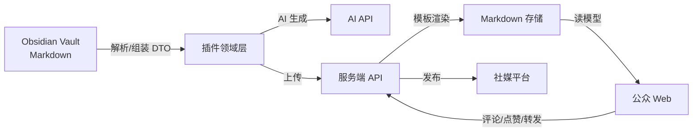

# 研究性学习社区 · 测试工具与测试策略评估

> 评估对象：Obsidian 插件（TypeScript）+ 服务端（md 模板服务 / 卡片上传保存 / 后台）+ 公众 Web 入口（领域与同学浏览、注册后评论点赞转发、讨论树）
> 评估日期：2026-11-13　版本：v1.0
> 结论口径：默认团队 2–4 人、Node/TS 单语言栈、GitHub/GitLab CI、国内网络环境、用户含未成年人。

---

## 0. 结论速览（先看这张表）

| 层 | 推荐 | 关键理由 | 明确不选 |
|---|---|---|---|
| 插件单元测试 | **Vitest 4 + `obsidian-test-mocks`**（内存版真实 App，`App.createConfigured__({files})`） | 覆盖全部 `obsidian.d.ts`，能在进程内造 vault、跑命令，秒级反馈，适合 PR 门禁 | 自写 300 行 stub（会漂移）、`jest-environment-obsidian`（已归档于 Obsidian 1.1.16） |
| 插件真实实例测试 | **`obsidian-integration-testing`**（真实 Obsidian + CDP/Appium，临时 `--user-data-dir`，版本矩阵） | Obsidian 无官方自动化通道，但社区已有把测试跑进真实实例的成熟 harness；可覆盖 `isTrusted` 输入、设置面板、CodeMirror | 用 Playwright 直接驱动 Obsidian（无稳定入口）；把这类测试塞进 PR 门禁（慢、需 GUI） |
| 服务端 | **Vitest + Fastify `app.inject()` + Testcontainers（Postgres/MinIO）** | 不占端口、不 mock 数据库、迁移与 SQL 语义（JSONB、递归 CTE、唯一约束）都真跑 | SQLite 替身（语义不同，会在生产爆炸） |
| 契约 | **OpenAPI 3.1 schema-first + 生成 TS 类型 + 响应校验 + `oasdiff` 破坏性变更门禁** | 三客户端同一 provider；成本低，能挡住 90% 漂移 | 一开始就上 Pact Broker（运维成本 > 收益，除非插件端发版与后端彻底解耦） |
| Web E2E | **Playwright 1.65+**（多 browser context 模拟多用户、`storageState` 按角色、trace） | 讨论树天然多用户并发，多 context 是刚需；Cypress 在这一项上吃力 | 只用 Cypress；用 Selenium 手写等待 |
| 测试数据 | **工厂 + 每 worker 独立 schema + 固定种子 + 注入 Clock/Id** | 并行不互相踩；失败可复现 | 共享一个可变测试库；把真实学生数据当夹具 |
| 观测 | trace id 贯穿 + 错误码枚举契约 | 线上定位成本直接决定 MTTR | 只在测试里 `console.log` |

**一句话结论**：这个项目的测试预算不应平均分配。把 60% 投在「插件数据转换与发布状态机」「服务端模板渲染与权限/幂等」「讨论树不变量」这三块；Web 只做 15–25 条关键旅程；社媒发布永远走假平台 + 人工放行。

---

## 1. 假定与系统边界

评估基于以下假定（若不成立需回改对应小节）：

- 服务端：Node/TS，Fastify 或 Express，PostgreSQL，对象存储（S3/MinIO），后台是同一服务下的 `/admin` 路由组。
- 插件：官方 sample plugin 结构（`main.js` 由 esbuild 打包，`manifest.json` + `versions.json`，`obsidian` 外置）。
- 外部依赖 4 个：AI 模型 API、社媒平台（发布）、对象存储、邮件/短信（注册验证）。
- 三端共享一份数据模型：`Card`（研究卡片）是其核心。

**风险最高的 5 个接缝**（后续测试都围绕它们）：



1. Vault → DTO（编码、路径、frontmatter）
2. DTO → AI 输出（非确定性）
3. DTO → 服务端（契约、幂等）
4. 服务端 → 社媒（外部副作用，不可回滚）
5. 讨论树（递归结构 × 权限 × 分页）

---

## 2. ① Obsidian 插件测试方案

### 2.1 官方 sample plugin 的「测试模式」真相

`obsidian-sample-plugin` **本身不带任何测试配置**——只有 `npm run dev`（esbuild watch）+ `build`。它的隐含测试模式是「装进 vault 手点」。这带来两个必须先解决的结构问题：

1. `obsidian` 这个 npm 包**只有 `obsidian.d.ts` 类型，没有运行时实现**。任何 import `obsidian` 的测试文件在 Node 里都会挂。所以"obsidian 模块 mock"不是可选项，是前置条件。
2. 插件里混着三类代码：纯逻辑、Obsidian API 调用、DOM 视图。混在一起时，测试只能靠重量级 mock，覆盖率上不去、维护成本爆炸。

**结论**：先做分层，再谈工具。分层是可测性的前提，工具只是杠杆。

### 2.2 三档测试阶梯（这是本节的主干建议）

| 档位 | 跑什么 | 载体 | 频率 | 预算 |
|---|---|---|---|---|
| **T1 单元（进程内）** | 解析、转换、状态机、校验、错误分类 | Vitest + `obsidian-test-mocks` | 每次 PR，< 60s | 60% 测试代码量 |
| **T2 集成（真实实例）** | 启用插件、真实 vault 读写、命令执行、设置面板、移动端 | `obsidian-integration-testing`（CDP / Appium） | 夜间 + 发版门禁 | 25% |
| **T3 人工冒烟** | 市场安装、真实 AI/社媒、社区评分 | 清单 + 录屏 | 每个 release | 15%（人力） |

T2 是很多人以为"做不到"的一档，但 2026 年生态已经具备：社区 harness 会在临时 `--user-data-dir` 里起一个隔离的 Obsidian，把构建产物装进临时 vault，用 `evalInObsidian` 在真实 `App` 上下文里执行断言，并支持 `runObsidianVersionMatrix` 在 latest public / catalyst 两个版本上各跑一遍。它同时解决了两件难事：**跨 Obsidian 版本兼容**、**`isTrusted` 输入（键盘、hover、CodeMirror 交互）**。

代价要提前认：需要 runner 上装 Obsidian 桌面版 + Node 22+，必须有 GUI 会话（Windows 自托管 runner，或 Linux + Xvfb），单轮 5–15 分钟。**所以它不该是 PR 门禁**，而是夜间与发版门禁。

### 2.3 jest vs vitest 决策

| 维度 | Vitest 4 | Jest 30 |
|---|---|---|
| TS/ESM 开箱 | 原生，零 babel | 需 ts-jest/babel，配置面大 |
| `vi.mock` 提升与模块级 mock | 一等公民，`import.meta` 友好 | 成熟但 `moduleNameMapper` 常踩坑 |
| 与 Obsidian 生态 | `obsidian-test-mocks` 提供 `vitest-setup` 一行接入；`obsidian-integration-testing` 提供 vitest globalSetup | 同上均支持，生态文档更多 |
| 覆盖 | v8（快） | istanbul（更准的 branch 语义） |
| 服务端复用 | 与 TS 服务端同一套配置 | 需两套 |
| 真实风险 | 团队不熟时 `vi.mock` 提升报错难懂 | 慢、ESM 仍别扭 |

**结论：选 Vitest**，插件与服务端共用一个 runner（一套配置心智、一份 coverage 口径、CI 只装一次）。只有当团队已有大量 Jest 用例/自研 jest preset 时才反过来。

### 2.4 obsidian 模块 mock 的两种做法

**做法 A（推荐）：用 `obsidian-test-mocks` 直接替换模块**

```ts
// vitest.config.ts（插件仓库）
import { defineConfig } from 'vitest/config';

export default defineConfig({
  test: {
    setupFiles: ['obsidian-test-mocks/vitest-setup'], // 注入原型扩展 + mock 掉 obsidian
    environment: 'node',                              // 只有视图测试用 jsdom
    coverage: { provider: 'v8', include: ['src/**'], exclude: ['src/view/**'] }
  }
});
```

```ts
// 一个真实形状的用例：造 vault → 跑命令 → 断言写回内容
import { App } from 'obsidian-test-mocks/obsidian';
import { toCardDto } from '../src/domain/card';

it('读取笔记并组装卡片 DTO', async () => {
  const app = App.createConfigured__({
    files: { '研究/光合作用.md': '---\ntitle: 光合作用\n---\n正文 #生物' }
  });
  const file = app.vault.getAbstractFileByPath('研究/光合作用.md');
  const md = await app.vault.cachedRead(file as any);
  expect(toCardDto(md, '研究/光合作用.md').domain).toBe('生物');
});
```

要点：**记住 mock 的实现永远只是"我们认为 Obsidian 怎么工作"**。它必漂移。防护两层：

- 依赖升级时跑一次 T2（真实实例）——这是唯一能证明 mock 没撒谎的手段；
- 给关键 API 加**类型契约测试**（`expect-type` / `tsd`），确保我们使用的签名与 `obsidian.d.ts` 一致，签名不符时 CI 直接红。

**做法 B：自写 stub + alias**（`resolve.alias: { obsidian: './tests/stubs/obsidian.ts' }`）。只在需要严格控制行为、或要模拟"Obsidian 未实现/抛错"的边界时用。别把它当主方案——手写 stub 的维护成本会随时间线性上升。

**历史坑（别踩）**：`jest-environment-obsidian` 已归档（停留在 Obsidian 1.1.16），网上大量教程仍在推荐它；`obsidian-test-kit`、`obsidian-mock` 均已被上面方案取代。选型时先看最后发布时间。

### 2.5 vault 文件操作测试

这是插件里最容易出线上事故、又最容易被敷衍的一块。分层测：

**L1 纯函数层（必须 100% 覆盖）**
`normalizeVaultPath()`、`toVaultLink()`、`slugify()`、`decodeFrontmatter()`、`mergeFrontmatter()`
用属性测试（`fast-check`）造输入，断言不变量：`normalize(normalize(x)) === normalize(x)`、`normalize` 不产生 `..`、不以 `/` 结尾、保留 CJK、对 NFD 输入做 NFC 归一。

**L2 假 vault（进程内，覆盖绝大多数场景）**
用 `obsidian-test-mocks` 的内存 vault，或自建 `FakeAdapter`（`memfs` 后端）。要覆盖的用例矩阵：

| 维度 | 用例 |
|---|---|
| 命名 | 空格、中文、emoji、`#`、`[]`、超长（>200 字符）、同名不同目录、大小写仅差一字母（macOS/Windows 冲突） |
| 编码 | NFC vs NFD（macOS 粘贴路径）、UTF-8 BOM、CRLF vs LF、混合制表符 |
| 结构 | 嵌套 5 层目录、`.obsidian` 排除、附件目录、软链接（桌面端） |
| 并发 | 上传中用户改名、上传中删除笔记、两个面板同时写同一笔记 |
| 原子性 | 写一半崩溃 → 不产生半截文件（应用 `vault.process()` 做读改写，或 write-temp + rename） |
| 事件 | `vault.on('rename')` / `'modify'` 触发后，卡片内链是否更新；外部同步工具造成的 modify 风暴是否被 debounce（用 `vi.useFakeTimers()` 断言只发一次） |

**L3 真实文件系统（少量）**
`tmpdir` 真跑一遍，重点抓 **平台语义差异**：macOS APFS 默认大小写不敏感、Windows 260 字符路径上限、Linux 大小写敏感。同一份用例在 CI 的三平台矩阵上跑，能提前抓到"我本地好的啊"类 bug。

**L4 移动端（少量，夜间）**
Obsidian 移动端走 SAF/iCloud，`adapter` 行为与桌面不同。用 T2 的 Appium 通道在 Android 模拟器上跑 3–5 条最关键用例（读笔记、写回、上传）。这一档多数团队会跳过，但"移动端写回失败"是该类插件的头号差评来源。

**移动端专属红线（可用 lint 断言，不必手测）**：移动端没有 Node 能力，网络必须走 `requestUrl` 而非 `fetch`（CORS 限制），且禁止 import `node:*`。加一条 ESLint `no-restricted-imports` + 自定义规则禁 `fetch(`，比写 10 个测试更有效。

### 2.6 建议的插件内部分层与边界规则

```
src/
  domain/        # 纯 TS，零 obsidian import —— 90% 测试预算在这里
  adapters/      # vault / http / ai / publisher / settings 的薄封装
  commands/      # 命令与状态机编排（可测，依赖注入）
  view/          # ItemView / Modal / SettingTab（薄，尽量无逻辑）
  main.ts        # Plugin 子类，只做装配
```

用 `dependency-cruiser` 加规则：`domain` 不得依赖 `obsidian`、`view` 不得被 `domain` 依赖。**这条 CI 规则的价值高于任何单个测试**——它保证日后新增代码不会把可测性重新弄丢。

视图层（`ItemView`/`Modal`）的 `createEl` 风格 DOM 在 jsdom 里可跑但保真度低（Obsidian 在 Electron/Chromium 里跑，且注入原型扩展如 `createDiv`）。建议：视图只做「读 view-model → 挂 DOM」，view-model 用纯函数算好并快照测试；真正的交互保真交给 T2。**不要为了给视图凑覆盖率去写大量脆弱的 DOM 断言**。

### 2.7 AI 调用与社媒发布的测试（本项目最独特的风险）

**AI：端口 + 假实现 + 录制回放**

```ts
interface AiClient { complete(req: AiRequest, signal?: AbortSignal): Promise<AiResult>; }
```
- CI 用 `FakeAiClient`：返回**结构合法**的 JSON（配 zod schema 校验）。
- 断言"结构"而不是"文本"：不对比自然语言输出（会天天红），只对比 DTO 字段、长度约束、引用完整性。
- 必测的失败面：超时、429、5xx、流式中断、返回非法 JSON（走 repair/降级路径）、超 token 截断、用户取消（`AbortSignal` 正确传递，不泄漏请求）、**笔记内容里的提示注入**（笔记写「忽略以上指令」不应改变输出结构）。
- 成本护栏测试：单次请求 token 上限、每日配额用尽后走缓存/提示而非静默烧钱。
- 可选：录制回放（Polly.js / nock recorder）存 5–10 条真实样本，作为"上游真的改协议了"的探针，夜间跑。

**社媒发布：outbox + 幂等 + 假平台**

这是"点一下按钮就有外部副作用"的场景，测试策略必须是**状态机 + 幂等**，而不是"点一下看结果"。

必测（全部离线，用 `FakePublisher`）：

1. 双击发布 → 只发一次（幂等键 = `hash(cardId + contentVersion)`）。
2. 上传成功、发布失败（429）→ outbox 保留待重试项，UI 显示「待重试」而非「已发布」；退避序列 1s/2s/4s…（`vi.useFakeTimers()` 断言）。
3. 进程在「上传成功、未发布」处被杀 → 重启后从 outbox 恢复，**不产生重复卡片**（服务端 409 duplicate 应被识别为成功）。
4. 服务端返回 409/网络超时但实际成功 → 客户端按幂等结果视为成功，不制造重复。
5. 平台返回审核拒绝/限流/账号失效 → 明确错误分类与用户可操作的提示文案。
6. 内容变更后重发 → 版本号自增，旧任务作废。

**永远不在 CI 里真发社媒**。理由不只是"会发垃圾内容"：账号风控、平台 ToS、以及失败后无法回滚。若必须验证平台真连通，做一条**手动触发的沙箱任务**（`workflow_dispatch`），用专用测试账号 + 固定草稿，且发布后自动删除。

### 2.8 生命周期、设置迁移与打包的"可测断言清单"

这些不是"测试用例"，而是**几条便宜且高回报的自动断言**，建议写进 CI：

- `onunload` 后无残留：`vi.getTimerCount() === 0`、注册的事件全部 dispose（用 spy 计数 `registerEvent`/`registerInterval`/`addCommand` 的返回值是否被清理）。
- 启用两次 / 禁用再启用：不重复注册命令、不抛错（幂等）。
- `loadData()` 返回旧版 schema / `null` / 损坏 JSON → 走迁移或重置，不崩。
- `manifest.json` 的 `version` 与 `package.json`、`versions.json`、`minAppVersion` 一致（脚本断言）。
- `main.js` 产物检查：无 `node:*` 内建、无 `eval`、体积 < 预算（如 300KB）、`obsidian` 保持 external。
- 构建产物能在 Node 里被 require（stub 掉 obsidian）——抓"打包后循环依赖/顶层副作用"这类只在发布时才炸的问题。

---

## 3. ② 服务端测试

### 3.1 四个独立战场

| 战场 | 为什么单独测 | 主要风险 |
|---|---|---|
| API 契约 | 三个客户端共用 | 字段漂移、错误码不统一、版本不兼容 |
| md 模板渲染 | 落库内容即产品内容 | 注入、格式破坏、不可回滚的历史卡片 |
| 数据库/存储 | 递归结构与并发写 | 讨论树环、计数漂移、重复卡片、迁移炸库 |
| 后台 admin | 权限最高、测试最少 | 越权、审计缺失、批量操作误伤 |

### 3.2 API 契约测试

**推荐路径：schema-first，代码即规格。**

1. 用 TypeBox / zod-to-openapi 从路由 schema 生成 `openapi.json`，CI 落盘并作为产物。
2. 用 `openapi-typescript` 生成客户端类型，插件与 Web 直接引用（**跨仓库发布成内部包**，否则你只是把漂移藏起来了）。
3. 服务端集成测试里对每个 2xx 响应做 schema 校验（`openapi-response-validator` / `jest-openapi` 等价物）。这一条能挡住"代码改了、文档没改"的整类问题。
4. CI 跑 `oasdiff breaking`：本次 PR 的 spec 与主干对比，破坏性变更（删字段、改类型、加必填、改枚举）**必须显式豁免**才能合。
5. 夜间跑 `schemathesis`（属性测试，从 OpenAPI 生成大量请求）：能自动发现 500、schema 违反、边界值崩溃。性价比极高，一条命令换一类 bug。

**必测的契约细节**（这类项目里最常被漏）：

- 错误体统一：`{ code, message, details?, traceId }`，`code` 是**封闭枚举**并有用例断言（客户端要靠它做分支）。
- 分页：cursor 语义（不是 offset），`nextCursor` 为空表示结束；越界 cursor 返回空列表而非 400。
- 幂等：`Idempotency-Key` 头语义（同键同体重放返回同一结果，同键异体返回 409）。
- 内容协商/编码：`Content-Type: application/json; charset=utf-8`，中文不转义也不乱码。
- 大小限制：请求体上限、单卡正文字数、附件大小 → 413 而非 500。
- 时间：所有时间戳 ISO-8601 UTC 带 `Z`；服务端不接受本地时间字符串。
- 版本策略：`/api/v1` 前缀 + `Sunset`/`Deprecation` 头；**旧插件版本必须能用**（见 §5.1）。

### 3.3 md 模板渲染测试（本项目最容易低估的一块）

先说结论：**如果模板是"字符串拼接/`{{}}` 替换"，先改成"DTO → mdast → 序列化"再谈测试**。字符串模板的测试永远是"补丁式用例"，而 AST 渲染可以让 round-trip 成为可断言的不变量。

必测：

| 类别 | 用例 |
|---|---|
| 结构保真 | 标题层级、有序/无序列表嵌套、表格含 `|`、代码块含 ```、引用块、脚注、数学 `$…$` |
| frontmatter | 值含 `:`、`#`、`---`、换行、引号、空值、数组；YAML 特殊字符必须被正确 quote（否则卡片解析全废） |
| 注入 | 正文含 `{{title}}`、``、`<!-- -->`、`</script>`、`javascript:` 链接、`` |
| 编码 | CRLF、BOM、tab、emoji、CJK 宽字符、RTL 混排、零宽字符 |
| 确定性 | 同一 DTO 渲染两次字节相同（禁止 `Date.now()`/随机 ID 进模板，改为注入 `Clock`/`IdGenerator`） |
| 幂等/往返 | `render(dto)` → `parse()` → 与原 DTO 等价（这条能一次性抓住 80% 的转义 bug） |
| 版本兼容 | 用 v1 卡片 + v3 渲染器渲染，输出与快照一致；渲染器升级不改写历史内容 |
| 体量 | 10 万字正文、1 万个列表项 → 不 OOM、耗时 < 2s |

**安全**：Web 端渲染 markdown → HTML 时必须过 sanitizer（`rehype-sanitize` / DOMPurify），并用 OWASP XSS 语料做一个 20 条的回归集。这类测试要放在"渲染边界"上（一次），而不是每个页面都测。

### 3.4 数据库与存储测试

**原则：不用 SQLite 替身。** 用 Testcontainers 起真 Postgres（+ MinIO），因为你要测的恰恰是 Postgres 语义：`JSONB`、`ON CONFLICT`、唯一约束、`citext`/collation、递归 CTE、事务隔离级别。SQLite 上全绿、生产上死锁，是这类项目最经典的翻车方式。

必测：

- **迁移**：空库 → 最新；每个历史版本的夹具库 → 最新；`down` 可回滚（或明确声明不可回滚并禁止使用）；迁移在 100 万行数据上的耗时与锁（用生成数据的 perf 用例，夜间跑）。
- **幂等上传**：同内容重复上传 → 唯一索引（`content_hash`）命中 → 返回既有卡片，`cards` 表行数不变。
- **并发点赞**：50 并发同一 `(cardId,userId)` → 只有 1 条 like；`like_count` 与明细一致（**这是最容易漂移的地方**，要么用事务计数、要么查询时聚合，二选一并写用例锁死）。
- **并发转发/评论**：计数与明细在 200 并发后一致。
- **编辑冲突**：`version`/ETag 乐观锁，两个客户端先后改 → 后者 409，不静默覆盖（研究笔记丢内容是致命的）。
- **软删除**：删卡片 → 评论是否级联隐藏；恢复后数据完整；被删卡片在列表/搜索/分享链接中的表现一致。
- **讨论树**（重点，见 §3.5）。
- **对象存储**：预签名 URL 有效期、`Content-Type`、大小上限、恶意文件（zip 炸弹、超长文件名）、孤立附件清理任务、删除卡片后附件 GC（不能误删被引用的）。
- **备份/恢复演练**（上线前必做一次）：从快照恢复到新库 → 跑一遍只读一致性校验（卡片数、评论数、附件引用完整性）。

### 3.5 讨论树的不变量测试

选型不影响测试内容，但影响成本。推荐**邻接表 + `parent_id` + 递归 CTE**（读多写少、深度有限时最省），并强制执行硬约束：

| 不变量 | 断言方式 |
|---|---|
| 无环 | 插入/移动后用递归 CTE 检测环，DB 层加 `CHECK (parent_id <> id)` + 应用层祖先校验 |
| 深度上限（如 5 层） | 第 6 层回复被拒绝（422）或自动挂到第 5 层并提示——**产品上必须有确定答案** |
| 父节点同卡 | 跨卡片回复 → 422（应用层 + 外键/触发器） |
| 已删父节点 | 子节点仍可见，显示「该评论已删除」占位，不整枝消失 |
| 分页稳定 | 插入新评论后翻页不重复/不丢（keyset 分页 `(created_at, id)`，禁用 offset） |
| 排序 | `new` 与 `hot` 各自有快照用例；hot 分数重算幂等 |
| 计数 | 根评论数/总回复数与明细一致（并发后仍一致） |
| 性能 | 1 万节点、深度 5、单卡 2000 评论：首屏 P95 < 300ms（数据生成脚本 + k6/explain 断言） |

### 3.6 后台 admin

后台是"权限最高、测试最少"的经典盲区。最低要求：

- **权限矩阵测试**（表驱动）：`角色 × 资源 × 动作`（student / teacher / admin / owner / 同班同学 / 陌生人 / 被封禁），逐格断言 2xx/403/404。**不要只测 happy path**。
- 越权测试：普通用户直接打 `/admin/*` 必须 403 且**响应体不泄露资源是否存在**（403 vs 404 的信息泄漏）。
- 审计：每次管理操作写 `audit_log`（谁、何时、对什么、改前改后），用例断言落库。
- 危险操作：批量删除/封禁需要二次确认 + 可撤销窗口；测试"误操作恢复"。
- 会话安全：CSRF token、会话固定、登录爆破限流、密码重置 token 一次性。

---

## 4. ③ 公众 Web E2E（Playwright）

### 4.1 可行性结论：高，且有明确边界

**可行**。理由不是"Playwright 流行"，而是三个具体需求它正好对上：

1. **多用户同时在线**是讨论树的核心场景。Playwright 的 `browser.newContext()` 让「A 发评论 / B 立刻看到并回复」在同一个测试里天然成立；Cypress 需要开多 tab/多 spec，基本放弃。
2. **认证态复用**：`storageState` 把"登录"变成一次性 setup，而不是每条用例点一遍登录（这是 E2E 慢和 flaky 的第一大来源）。
3. **失败可诊断**：trace viewer 能回放 DOM 快照 + 网络 + 控制台，这对"评论发出去但没显示"这类问题几乎是唯一高效的定位手段。

**边界**：
- 只做 Chromium 门禁，WebKit 夜间跑（覆盖 iOS Safari 分享落地页），Firefox 可选。
- **微信内置浏览器（X5/XWeb）无法用 Playwright 驱动**——分享落地页必须真机人工冒烟，或用云真机平台。
- 视觉回归只做 3–5 个稳定页面，否则维护成本会吃掉收益。

### 4.2 认证态设计

```ts
// e2e/auth.setup.ts —— 走 API 登录，不走 UI
import { test as setup } from '@playwright/test';

const roles = [
  { name: 'student',      email: 's1@test.local' },
  { name: 'classmate',    email: 's2@test.local' },
  { name: 'teacher',      email: 't1@test.local' },
  { name: 'admin',        email: 'admin@test.local' },
];

for (const r of roles) {
  setup(`认证：${r.name}`, async ({ request }) => {
    await request.post('/api/v1/auth/login', { data: { email: r.email, password: 'Test1234!' } });
    await request.storageState({ path: `.auth/${r.name}.json` });
  });
}
```

```ts
// playwright.config.ts
projects: [
  { name: 'setup', testMatch: /auth\.setup\.ts/ },
  { name: 'anon',    use: { ...devices['Desktop Chrome'] }, testMatch: /public\/.*/ },
  { name: 'student', use: { ...devices['Desktop Chrome'], storageState: '.auth/student.json' },
    dependencies: ['setup'], testMatch: /(auth|comment|discussion)\/.*/ },
  { name: 'admin',   use: { storageState: '.auth/admin.json' }, dependencies: ['setup'] },
  { name: 'mobile',  use: { ...devices['iPhone 14'] }, testMatch: /share\/.*/ },
]
```

必须覆盖的认证态场景（这些比"能登录"重要得多）：

| 场景 | 断言 |
|---|---|
| 未登录访问讨论页 | 可读、可看评论；写入动作弹出登录引导并保留 `?next=`，登录后回到原评论框位置 |
| 会话过期（token 失效） | 不白屏、不无限转圈；提示重新登录；**已输入的评论草稿不丢**（localStorage 恢复） |
| 多标签登出 | A 标签登出 → B 标签下次操作跳登录（`BroadcastChannel`/storage 事件） |
| 角色越权 | 学生访问教师后台 URL → 403 页面而非 500 或空壳 |
| 分享链接未登录 | 卡片摘要可见（OG 卡片），评论需登录；OG meta 必须存在（社媒抓取靠它） |
| OAuth（如微信/学校账号） | 用 `page.route()` 拦截 IdP，回放授权码；断言 state 校验、错误回调、取消授权 |

### 4.3 讨论树 E2E 场景清单（15 条以内，够用）

| # | 场景 | 关键断言 | 常见陷阱 |
|---|---|---|---|
| 1 | A 发根评论 → B 刷新可见 | 内容/作者/时间正确 | 乐观 UI 却没真落库 |
| 2 | B 立即回复（不刷新） | 实时更新（SSE/WS）或轮询生效 | 用 `waitForTimeout` 掩盖 |
| 3 | 5 层嵌套渲染 | 缩进正确、折叠可展开 | 深层 CSS 溢出、移动端不可读 |
| 4 | 回复第 3 层 | 新评论挂在正确父节点 | 把 `rootId` 当 `parentId` |
| 5 | 折叠/展开后刷新 | 折叠状态保持（按用户持久化） | 一刷新全展开 |
| 6 | 200 条评论加载更多 | 追加不重复、不丢、滚动位置保持 | offset 分页导致重复 |
| 7 | 发评论时服务端 500 | 回滚、草稿保留、可重试 | 内容凭空消失 |
| 8 | 快速双击提交 | 只生成 1 条（按钮禁用 + 服务端幂等） | 两条重复评论 |
| 9 | 删除自己的评论（有子回复） | 显示占位，子回复仍在 | 整枝消失 |
| 10 | 删除他人评论 | 无入口 + 直连 API 403 | 前端隐藏=假安全 |
| 11 | 点赞/取消点赞 | 计数 ±1、刷新后一致、并发两次只算一次 | 前端自增与后端漂移 |
| 12 | 转发到站内/站外 | 站内生成引用卡片、站外分享链接可打开 | 分享链接 404 |
| 13 | 按领域筛选 + 分页 | URL 可分享、返回时筛选保持 | 筛选丢失 |
| 14 | 按同学浏览（同学录） | 只显示同班/同校可见内容 | 越权看到外班 |
| 15 | 键盘与无障碍 | Tab 可达、Enter 发送、`aria-label` 齐全 | 评论框无 label |

### 4.4 稳定性工程（决定 E2E 是资产还是负债）

- **零 `waitForTimeout`**：只用 web-first 断言（`expect(locator).toBeVisible()`）+ `expect.poll` 等异步结果。
- **数据自种**：每条用例通过 API/工厂造自己的数据（唯一前缀 `t-${testInfo.testId}-`），不依赖"库里刚好有 3 条评论"。并行时不互相污染。
- **隔离**：每 worker 一个 schema/租户（见 §5.3）；`fullyParallel: true`。
- **重试策略**：CI 上 `retries: 1`，但**重试通过要进 quarantine 清单**，每周清理；flaky 率 > 2% 就停下来修，不要习惯性重启。
- **失败留证**：`trace: 'on-first-retry'`、`video: 'retain-on-failure'`、`screenshot: 'only-on-failure'`，CI 上传 report 产物。
- **弱网**：用 CDP `Network.emulateNetworkConditions`（慢 3G + 400ms 延迟）跑 2 条关键用例（发评论、加载更多），验证骨架屏与超时提示。
- **视觉**：`toHaveScreenshot` 仅 3–5 页，固定字体（CJK 字体在各 OS 渲染差异极大，必须在固定容器里跑，否则天天红），并 `mask` 掉时间/头像/计数。

### 4.5 可访问性

`@axe-core/playwright` 扫 5 个页面：首页、领域页、卡片详情、讨论页、注册页。先修 serious/critical，其余进 backlog。讨论树的 `aria-expanded`/`role="treeitem"` 是最常被漏的。

### 4.6 明确不要做 E2E 的部分

纯样式微调、文案、后端分支逻辑、管理后台的每个 CRUD 表单（用 3 条代表性命中即可）、一次性数据迁移。E2E 只保护"用户能完成的事"，不保护"代码正确性"。

---

## 5. ④ 契约/集成测试与测试数据管理

### 5.1 拓扑，以及一个被低估的事实

1 个 provider（服务端）× 3 个 consumer（插件、Web、后台）。

**关键事实：Obsidian 插件是分发到用户机器上的产物，你无法强制升级。** 因此"服务端向后兼容"不是架构美德，而是**测试需求**：线上会长期存在 N-2 个版本的插件在调你的 API。这直接决定了三件事：

1. API 只加不改；破坏性变更走 `/v2` + 兼容层 + `Sunset` 头。
2. CI 里必须有一条「旧客户端回放」测试（见 5.2 方案 C）。
3. 服务端集成测试里保留至少 2 个历史版本的请求夹具。

### 5.2 三种契约方案与推荐组合

| 方案 | 机制 | 成本 | 适用 |
|---|---|---|---|
| A. OpenAPI + 生成类型 + 响应校验 | 服务端产 spec，客户端 codegen，CI diff | 低（1–2 人日搭建） | **默认，必选** |
| B. Pact consumer-driven + Broker | 消费者发布契约，provider 验证 | 中高（Broker 运维、pipeline 编排） | 多团队、发版节奏完全解耦、≥5 人维护 |
| C. 冻结夹具回放 | 每次插件发版把真实请求/响应存进 `fixtures/contracts/vX/`，服务端 CI 回放 | 低 | **替代 B 的性价比方案**，专治旧客户端兼容 |

**推荐：A + C**。B 留给"插件与服务端由不同团队维护且各季度才同步一次"的情形。理由：A 覆盖日常漂移，C 覆盖"三个月前的插件还能不能用"——而后者正是 B 想解决的痛点，但 C 只需要一个目录和一条 map 断言。

回放测试长这样（伪代码）：

```ts
for (const v of ['v1.4', 'v1.6', 'v2.0']) {
  test(`旧客户端 ${v} 的上传请求仍被接受`, async () => {
    const req = await loadFixture(`contracts/${v}/upload-card.request.json`);
    const res = await app.inject({ method: 'POST', url: '/api/v1/cards', payload: req.body, headers: req.headers });
    expect(res.statusCode).toBeLessThan(300);
    expectValidAgainst(loadFixture(`contracts/${v}/upload-card.schema.json`), res.json());
  });
}
```

### 5.3 集成测试夹具（Harness）

一个 harness 同时供服务端集成测试与 E2E 使用：

```yaml
# docker-compose.test.yml（或 Testcontainers 等价物）
services:
  db:    { image: postgres:17,  environment: { POSTGRES_DB: app_test } }
  minio: { image: minio/minio, command: server /data --console-address ":9001" }
  api:   { build: ., environment: { DATABASE_URL: ..., MAIL: fake, AI: fake, SOCIAL: fake } }
```

规则：
- **每 worker 一个 schema**（`app_test_w1`…），`beforeAll` 建 schema + 跑迁移（迁移脚本幂等，用 `migrate --to latest`），`afterAll` drop。比"每测试一个容器"快一个数量级。
- 单测级别用**事务回滚**（`beforeEach` BEGIN / `afterEach` ROLLBACK），只有需要真并发的用例才提交。
- 外部依赖全部替身：邮件/短信 → 本地收件箱 API；AI → FakeAiClient；社媒 → FakePublisher；对象存储用真 MinIO（便宜且能测 SDK 行为）。

### 5.4 测试数据管理

| 层 | 做法 | 位置 |
|---|---|---|
| 纯函数夹具 | 静态文件，人可读，进 code review | `fixtures/markdown/**`（含 25 个边界文件） |
| 实体 | 工厂函数 + `faker.seed(42)`，`buildCard({domain:'生物'})` | `test/factories/*` |
| 场景 | JSON/SQL 种子：`tree-depth5-200.json`、`class-of-30.sql` | `fixtures/scenarios/*` |
| 性能 | 生成脚本（不提交数据，只提交脚本 + 参数） | `scripts/gen-load.ts` |
| 回归 | 生产快照**脱敏**后导入（仅夜间/预发） | 不入仓 |

四条硬规则：

1. **确定性**：所有时间走注入的 `Clock`；所有 ID 走注入的 `IdGenerator`（测试用递增）。任何 `Date.now()` 出现在 domain 层都算 bug。
2. **隔离**：并行测试不得共享可变状态；E2E 每条用例的数据带唯一前缀并在 `afterEach` 清理（或整库重建）。
3. **夹具漂移防护**：CI 里用当前 schema 校验所有 `fixtures/**/*.json`——夹具过期会让测试"绿得毫无意义"。
4. **隐私红线（本项目特有）**：用户是研究性学习的学生，**大概率含未成年人**。禁止把真实学生姓名、班级、手机号、作文内容放进仓库、测试报告、CI 日志或截图。合成数据必须显式标注 `SYNTHETIC`；日志脱敏断言（"错误日志不含 email/手机号"）本身就是一条测试。生产快照只能脱敏后用于预发，且访问受控。

### 5.5 外部依赖替身矩阵

| 依赖 | 单测 | 集成 | 夜间 | 手动 |
|---|---|---|---|---|
| AI | Fake（固定 JSON） | Fake + schema 校验 | 录制回放 5 条真实样本（限额） | 发版前真跑 3 篇 |
| 社媒 | FakePublisher | FakePublisher | 无 | 沙箱账号 + 人工放行 |
| 邮件/短信 | 内存收件箱 | 本地 SMTP sink | 无 | 预发真发一次 |
| 对象存储 | 内存 | MinIO | 无 | 无 |
| 支付/捐赠（若有） | Fake | 沙箱 | 沙箱对账 | 上线前人工一笔小额 |

---

## 6. ⑤ 推荐工具栈、CI 与各层覆盖重点

### 6.1 工具栈总表

| 用途 | 选型 | 备注 |
|---|---|---|
| Runner | Vitest 4（插件 + 服务端 + Web 单测） | 单一 runner，coverage v8 |
| Obsidian 单测 | `obsidian-test-mocks` v8 | `vitest-setup` 一行接入，内存 vault |
| Obsidian 真实实例 | `obsidian-integration-testing` v18（CDP 桌面 / Appium Android） | 需装 Obsidian + Node 22+，GUI runner |
| HTTP 服务端测试 | Fastify `app.inject()`（light-my-request） | 不开端口，快 3–5 倍 |
| 容器 | Testcontainers（PG + MinIO） | `TESTCONTAINERS_REUSE_ENABLE=1` 提速 |
| HTTP mock | MSW（Node 侧） | 插件/Web 共用 handler |
| 属性测试 | `fast-check` | 路径、分页、树不变量 |
| 契约 | `openapi-typescript` + `openapi-response-validator` + `oasdiff` + `schemathesis` | 前三个进 PR，schemathesis 夜间 |
| E2E | Playwright 1.65+ | Chromium 门禁 / WebKit 夜间 |
| 组件测试（Web） | Testing Library + jsdom（可选） | 只在需要细粒度时补 |
| 可访问性 | `@axe-core/playwright` | 5 页基线 |
| 负载 | k6 | 上传、列表、讨论树 3 个场景 |
| 变异测试 | Stryker（仅 domain 与模板模块） | 夜间，季度跑 |
| 静态检查 | ESLint(typescript-eslint) + `dependency-cruiser` + `knip` + `tsc --noEmit` | 边界规则价值 > 单个测试 |
| 安全 | `osv-scanner`/`npm audit` + Semgrep + `gitleaks` + Trivy + ZAP baseline | 夜间 + 镜像构建时 |

> 国内网络提示：npm 走镜像（`npmmirror`），Playwright 浏览器与 Obsidian 安装包**预热到自托管 runner**（官方 CDN 在 CI 上经常超时，这是"CI 天天红"的隐形头号原因）。

### 6.2 各层覆盖重点（数字 + 理由 + 不追的地方）

| 层 | 目标 | 重点 | 明确不追 |
|---|---|---|---|
| 插件 domain/adapters | **行 90% / 分支 85%** | 解析、DTO、发布状态机、错误分类、路径归一 | `main.ts` 装配代码、类型文件 |
| 插件整体 | 65–75% | 命令层与状态机 | `view/` 的 DOM 细节（改用 T2 + 快照） |
| 服务端 | **80–85%**；模板/权限/幂等 **≈95%** | 渲染、authz、幂等、讨论树、迁移 | 生成代码、一次性脚本、SDK 封装 |
| Web | 单测 50–60% + 15–25 条 E2E | 认证分支、讨论树交互、错误态 | 纯样式、文案 |
| 后台 | 70% + 权限矩阵全格 | 越权、审计、批量操作 | 每个表单的字段级校验 |

覆盖率是**下限门槛**而不是目标。更值得盯的三个指标：

- **缺陷逃逸率**（上线后发现的 bug / 总 bug）目标 < 5%
- **E2E flaky 率** 目标 < 2%
- **PR 反馈时长** 目标 < 6 分钟（超过就会有人绕过流程）

### 6.3 CI 流水线（分四档，按代价分级）

| 阶段 | 触发 | 内容 | 预算 |
|---|---|---|---|
| **P1 快检** | 每次 push | lint + `tsc` + 边界规则 + 插件单测 + 服务端单测 + Web 单测 + 构建产物检查 | **≤ 6 min** |
| **P2 集成** | PR | Testcontainers 集成测试 + 契约响应校验 + `oasdiff` 破坏性检查 + 迁移从零跑一遍 | ≤ 15 min |
| **P3 E2E 冒烟** | PR（或合并前） | Chromium，8–10 条关键旅程，2 shard | ≤ 10 min |
| **P4 夜间/发布** | 定时 + tag | 全量 E2E（三浏览器）+ 视觉 + axe + schemathesis + k6 + Stryker + 真实 Obsidian 版本矩阵 + 安全扫描 + 备份恢复演练（周） | ≤ 45 min |

实现要点：
- 单仓（monorepo）用 pnpm workspace + Turborepo，**只跑受影响的包**（`--filter=...[origin/main]`）。
- 缓存：pnpm store、Playwright 浏览器、Testcontainers 镜像、esbuild 产物。
- 并发：`concurrency: { group: ${{github.ref}}, cancel-in-progress: true }`。
- 门禁：主干保护要求 P1+P2 绿；`oasdiff` 破坏性变更需要 label `api-breaking` 才能合。
- 产物：coverage（Codecov）、Playwright HTML report + trace、JUnit XML、k6 摘要。**没有产物的失败等于没失败**。

**Runner 选择**：P1–P3 用托管 runner 足够；P4 里"真实 Obsidian"必须自托管（Windows 带 GUI 会话，或 Linux + Xvfb），并预装 Obsidian 安装包。国内团队若用 GitLab/Gitee，同样的分级照样成立，只是缓存与镜像源要换。

### 6.4 质量度量与守门

| 指标 | 目标 | 用途 |
|---|---|---|
| 逃逸缺陷率 | < 5% | 判断"我们的测试是不是在测该测的" |
| 每个线上 P0/P1 bug 的回归用例 | 100% 补上 | 最有效的测试增长方式 |
| flaky 用例数 | < 2%，每周清零 | E2E 可信度 |
| CI 绿灯率（主干） | > 95% | 红灯常态化 = 流程失效 |
| domain 变异分数 | > 70% | 反"高覆盖低有效" |

---

## 7. ⑥ 可测试性风险与规避建议

按"发生概率 × 影响"排序。**最后一列才是真正的动作**。

| # | 风险 | 概率/影响 | 规避动作 |
|---|---|---|---|
| 1 | **obsidian mock 与真实 API 漂移**（断言全绿但线上崩） | 高 / 高 | 分层到 `adapters/`；mock 升级跟版本；夜间跑真实实例矩阵；类型契约测试；OBSIDIAN 大版本升级当天跑一次 T2 |
| 2 | **社媒发布不可回滚**（发错内容、重复发、账号被封） | 中 / 极高 | outbox + 幂等键 + 草稿态 + 人工放行开关；发布前 dry-run 预览；FakePublisher 覆盖全部失败路径；真实发布只在手动 workflow |
| 3 | **插件版本滞后撞上 API 变更** | 高 / 高 | `/v1` 只加不改；冻结夹具回放最近 2 个大版本；`Sunset` 头与版本下架策略；服务端兼容层有独立测试 |
| 4 | **md 模板字符串拼接导致注入/结构破坏** | 高 / 高 | 改 AST 渲染（mdast）；round-trip 不变量；XSS 语料集；frontmatter 转义专门用例；历史卡片用旧渲染器版本快照锁死 |
| 5 | **讨论树递归查询在真实数据量下垮** | 中 / 高 | 深度上限写进契约；keyset 分页；1 万节点性能用例进夜间；`EXPLAIN` 断言（不许 seq scan 全表） |
| 6 | **并发下计数漂移**（点赞数 ≠ 明细） | 中 / 中 | 唯一约束 + 事务内计数或纯聚合读；200 并发用例；对账脚本 |
| 7 | **文件系统语义差异**（macOS 大小写/NFD、Windows 长路径、移动端 SAF） | 高 / 中 | 三平台矩阵跑同一套路径用例；`normalizePath` 属性测试；Android 用 Appium 跑 3 条 |
| 8 | **AI 非确定性使测试不可重复/烧钱** | 高 / 中 | 端口 + Fake + schema 断言（不比文本）；真调用限额并只在夜间；prompt 版本化 |
| 9 | **认证态矩阵爆炸**（游客/学生/教师/管理员/封禁/过期） | 高 / 中 | 角色 `storageState`；表驱动权限矩阵；统一 auth 中间件（只测一次而不是每路由一次） |
| 10 | **未成年人数据进测试**（合规与伦理事故） | 中 / 极高 | 合成数据强制标记；脱敏断言；快照入库需审批；截图水印 `SYNTHETIC` |
| 11 | **移动端/微信内浏览器不可自动化** | 高 / 中 | 分享落地页做真机人工清单；OG meta 单测；降级页面（不支持时仍可读） |
| 12 | **后台 admin 被漏测**（最高权限 × 最低覆盖） | 高 / 高 | 权限矩阵全格 + 审计断言 + 越权用例；admin 与业务 API 同一套契约校验 |
| 13 | **时间/时区/排序**（定时发布、审核窗口、`hot` 排序） | 中 / 中 | 注入 Clock；UTC 存储；跨时区用例（`Asia/Shanghai` vs `UTC`）；排序快照 |
| 14 | **可观测性缺口**（线上报错无法定位） | 中 / 高 | 错误响应必带 `traceId` 并有断言；错误码枚举封闭；日志脱敏断言；合成监控拨测主链路 |

### 7.1 需要「现在」改架构才可测的 5 件事

如果不做，后面所有测试策略都会打折：

1. **插件分层 + 边界 lint**：`domain` 不许 import `obsidian`。1 天工作量，决定后面 6 个月的测试成本。
2. **所有外部副作用走端口**（AI / 社媒 / 存储 / 通知），构造注入，禁止模块级单例。
3. **注入 `Clock` 与 `IdGenerator`**：否则渲染不可比、测试不可复现。
4. **模板渲染改成 AST 序列化**：字符串模板的测试永远补不完。
5. **DTO 边界用 zod 做 parse-don't-validate**：三端共用同一份 schema 包，契约测试自动成立一半。

---

## 8. ⑦ 分阶段测试计划（MVP → 上线）

假设 1 名测试/质量负责人 + 全员写测试，共 15 周。人力单位：人日。

### Phase 0 · 地基（第 1–2 周，6 人日）

| 交付 | 退出标准 |
|---|---|
| Vitest 双 project（插件/服务端）+ coverage 门槛 | `pnpm test` 在空仓库跑通，CI 三条流水线（P1/P2/P3 骨架）绿 |
| `obsidian-test-mocks` 接入 + 1 个端到端内存用例 | 能"造 vault → 跑命令 → 断言写回" |
| OpenAPI 骨架（3 个端点）+ 类型生成 + 响应校验 | 契约测试 1 条通过 |
| Testcontainers PG/MinIO harness + 迁移基线 | 空库→最新迁移可重复执行 |
| Playwright 骨架 + 4 角色 storageState | 匿名用户能打开首页（1 条 E2E） |
| 分层与边界规则（dependency-cruiser） | domain 层违规会让 CI 红 |

> 这一阶段的产出不是"测试多"，而是"以后加测试很便宜"。**不要跳过。**

### Phase 1 · MVP 主链路（第 3–6 周，18 人日）

范围：**只测一条纵向链路** —— 笔记 → 生成卡片 → 上传 → 模板渲染 → 落库 → Web 可见。

| 层 | 新增测试 | 目标 |
|---|---|---|
| 插件 | 解析/DTO/路径 30 条；发布状态机 12 条（含幂等、重试、半途崩溃）；设置迁移 3 条 | domain 覆盖 ≥ 80% |
| 服务端 | 上传/保存 8 条契约 + 6 条集成；渲染 20 条（含 round-trip）；幂等 4 条 | 上传路径分支 90% |
| E2E | 1 条：插件上传后 Web 能看到（可用 API 造卡片替代插件） | 主链路零人工回归 |
| 外部 | Fake AI / Fake Publisher / Fake Mail 全部就位 | CI 无任何真实外呼 |

**退出标准（MVP 可内测）**：主链路 E2E 绿；CI 全绿率 > 90%；已知 P0 bug = 0。

### Phase 2 · 内测：社交与权限（第 7–10 周，22 人日）

| 层 | 新增 | 目标 |
|---|---|---|
| 服务端 | 权限矩阵（7 角色 × 6 资源 × 5 动作）；讨论树不变量 12 条；并发点赞/转发 4 条；软删除 4 条 | 权限与树分支 ≥ 90% |
| 契约 | `oasdiff` 门禁 + 冻结夹具回放（v1.0 插件） | 破坏性变更无法静默合入 |
| E2E | 讨论树 10 条 + 认证态 6 条 + 移动端 3 条 | Chromium 全绿，flaky < 3% |
| 性能 | k6：上传 50 RPS、列表 P95 < 300ms、1 万节点讨论树 | 达到 SLO |
| 可访问性 | axe 5 页基线 | 无 critical |

**退出标准（可公测）**：E2E flaky < 2%；权限矩阵 100% 覆盖；性能达标；备份恢复演练成功一次。

### Phase 3 · 公测：稳定性与安全（第 11–14 周，16 人日）

- 三浏览器全量 E2E + 视觉基线 3 页；弱网用例 2 条；真机（微信内浏览器）人工清单。
- 安全：Semgrep/ZAP baseline 清零高危；`gitleaks` 历史扫描；依赖漏洞 < 阈值。
- 插件：真实 Obsidian 版本矩阵（latest public + catalyst）跑通；Android 模拟器 3 条。
- 混沌/故障注入：AI 超时、存储 503、DB 主从切换 → 用户看到的是可理解的错误而不是白屏。
- 灰度与回滚演练：feature flag 关掉发布功能，验证卡片仍可上传/浏览。

**退出标准（可上线）**：无 P0/P1 未决；回滚演练通过；合成监控就绪。

### Phase 4 · 上线与运营（第 15 周起，持续 2 人日/周）

- **合成监控**（真流量拨测）：注册 → 发帖 → 评论 → 分享，每 5 分钟一次，用专用测试账号且内容自动隐藏。
- 每个线上 P0/P1 → 必须补一条回归用例（写进 DoD）。
- 每周 30 分钟 flaky 治理；每季度：变异测试、测试债审计、删掉没抓住过 bug 的测试。
- 插件每发一版：跑真实实例矩阵 + 冻结夹具入库 + 人工渠道冒烟清单。

### 测试金字塔目标（随阶段演进）

| 阶段 | 单测 : 集成 : E2E | 说明 |
|---|---|---|
| MVP | 70 : 25 : 5 | 先把逻辑钉死 |
| 内测 | 60 : 30 : 10 | 加多用户与权限 |
| 上线后 | 55 : 32 : 13 | E2E 稳定后小幅提升 |

### 明确"不做"的清单（省 20% 预算）

- 不给 `view/` 的每个 DOM 节点写断言（用 view-model 快照 + T2 真实实例）。
- 不追 100% 覆盖率（生成代码、类型、一次性脚本排除）。
- 不为管理后台的每个字段写 E2E。
- 不做像素级视觉回归（只 3 页，且固定容器）。
- 不在 PR 阶段跑真实 Obsidian / 真实 AI / 真实社媒。

---

## 9. 附录：第 1–2 周可执行的 12 个动作

1. 建 `packages/{plugin,server,web,shared-schema}`；`shared-schema` 放 zod DTO。
2. 插件加 `dependency-cruiser`，禁 `domain → obsidian`。
3. 接 `obsidian-test-mocks`，写第一个"造 vault → 跑命令"用例。
4. 定义 `AiClient` / `Publisher` / `Storage` 三个端口 + Fake 实现。
5. 抽 `Clock` / `IdGenerator`，替换所有 `Date.now()` / `randomUUID()`。
6. 服务端产 `openapi.json`，接 `openapi-typescript`，生成到 `shared-schema`。
7. 起 Testcontainers harness，迁移脚本改幂等。
8. 写 3 条契约测试 + 1 条渲染 round-trip 测试。
9. Playwright 骨架 + 4 角色 `storageState` + 1 条匿名用例。
10. 三条 CI（P1/P2/P3）落 YAML，加缓存与并发取消。
11. 建 `fixtures/` 目录结构与 25 个 markdown 边界文件。
12. 写一页《发布前人工清单》（含真机、市场安装、社媒沙箱）。

---

### 参考与依据

- [Announcing Vitest 4.0](https://voidzero.dev/posts/announcing-vitest-4) — runner 选型与 v8 覆盖
- [obsidian-test-mocks](https://www.npmjs.com/package/obsidian-test-mocks) — 内存实现完整 `obsidian.d.ts`，提供 `vitest-setup` / `jest-setup`，并与已归档的 `jest-environment-obsidian`、`obsidian-test-kit` 做了对比
- [obsidian-integration-testing](https://www.npmjs.com/package/obsidian-integration-testing) — 真实 Obsidian 内跑测试（桌面 CDP / Android Appium、临时 user-data-dir、版本矩阵、`isTrusted` 输入、截图），并对比了 `wdio-obsidian-service`、`obsidian-e2e`、`obsidian-e2e-toolkit`（Playwright fixtures）等替代品
- [Obsidian Dev Toolkit · E2E Testing](https://mnaoumov.dev/obsidian-dev-toolkit/guides/e2e-testing/) — demo vault、按按钮渲染结果断言、移动端部署（ADB）等工程化路径
- [Playwright 1.65](https://newreleases.io/project/github/microsoft/playwright-dotnet/release/v1.65.0) — E2E runner 版本基线

> 说明：本报告基于"Node/TS 单栈 + Postgres"的假定。若服务端为 Python，第二节的 DB/契约结论不变，工具换成 `pytest + httpx + testcontainers-python + schemathesis`；插件与 Web 部分不受影响。
